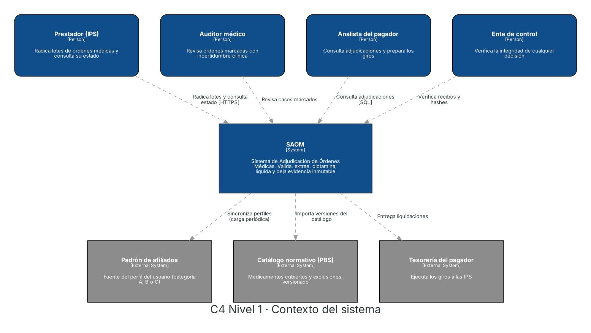
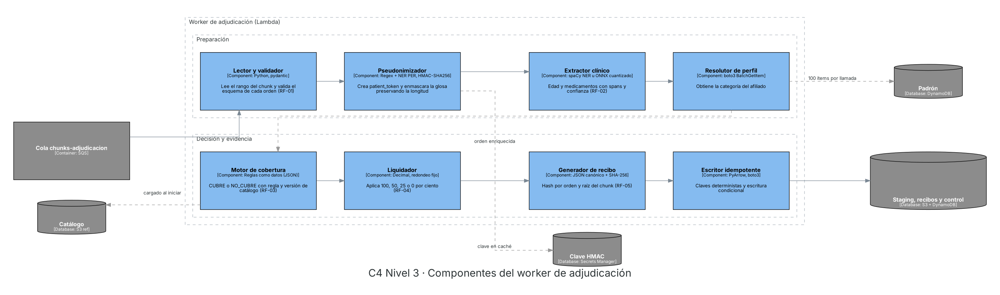
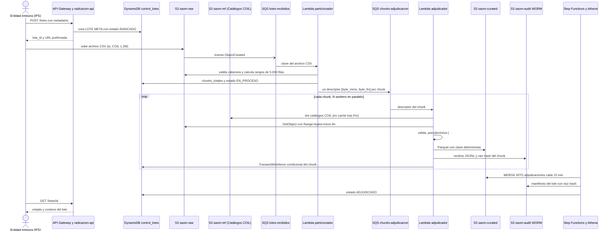

# Diseño de Arquitectura Técnica y Diagrama de Componentes en AWS

| Campo | Valor |
| :--- | :--- |
| Proyecto | Arquitectura distribuida en AWS para auditoría y adjudicación masiva de órdenes médicas (Proyecto COIL · Sistema de Salud de Chernovia) |
| Entregable | 2, Diseño técnico (diagrama y justificación) |
| Fase AI-DLC | Construction, diseño de infraestructura |
| Versión | 1.0.0 (Alineado con el Dataset Oficial COIL de 1,2M de solicitudes) |
| Depende de | ADR-001, ADR-002, ADR-003, RF-01 a RF-05, RNF-01 a RNF-06 |
| Decisiones nuevas | [ADR-004](adrs/ADR-004-computo-workers-lambda.md) y [ADR-005](adrs/ADR-005-almacenamiento-poliglota.md) |

---

## 1. Resumen de la decisión

La solución es una arquitectura **cloud native y orientada a eventos** que materializa la ruta híbrida de ADR-001 para el **Sistema de Salud de Chernovia (Proyecto COIL)**. Las entidades emisoras (`entidad_emisora`) radican lotes CSV de manera continua a través de 7 canales (`medio_emisor`) y los suben directamente a Amazon S3 mediante una URL prefirmada. Cada archivo se divide en chunks de 5.000 órdenes por rango de bytes que una cola SQS reparte entre $N$ funciones Lambda en paralelo. Cada función ejecuta la cadena completa de la solicitud (`id_solicitud`): validación sintáctica, pseudonimización con preservación de longitud (`#`), extracción de entidades de la glosa con desplazamientos `[start_char, end_char]`, dictamen contra `COIL_catalogo_servicios_cubiertos.csv` (`COV-001` a `COV-020`), liquidación según `COIL_catalogo_perfiles_cobertura.csv` (`PRIORITARIO` 100 %, `ESTANDAR` 50 %, `COPAGO` 25 %, `NO_CUBRE` 0 %) y firma criptográfica SHA-256 sobre JSON canónico. El worker deja tres salidas: una tabla analítica Apache Iceberg consultable con Athena, recibos inmutables en un bucket WORM y el estado operativo en DynamoDB. CloudWatch observa todo el recorrido sin registrar datos personales.

El dimensionamiento con teoría de colas ($M/M/c$) muestra que entre 1 y 56 workers concurrentes bastan para cumplir tanto la ventana de 24 horas como la ventana exigente de 3 horas, según el rendimiento real $k$ del extractor clínico. Al resolverse el perfil de cobertura en memoria con el catálogo oficial COIL, el costo de nube ronda **0,25 USD por millón de órdenes** (**3,02 USD al día** o unos **91 USD al mes** para 12 millones diarios; 3,77 USD/día si opcionalmente se consulta un padrón externo en DynamoDB), de modo que la variable económica decisiva no es la infraestructura sino la fracción de órdenes que terminan en revisión manual (sección 11).

---

## 2. Parámetros verificados con el Dataset Oficial COIL y supuestos de diseño

La inspección del conjunto de datos oficial (`COIL_dataset_glosas_salud_1_2M.csv`, 360,35 MB, 1.200.000 solicitudes en 3 días hábiles) permitió confirmar empíricamente los parámetros de entrada y despejar los supuestos iniciales:

| ID | Parámetro / Supuesto | Estado con el Dataset Oficial COIL | Efecto en el diseño |
| :--- | :--- | :--- | :--- |
| **S-01** | Origen del perfil de cobertura (`PRIORITARIO` 100 %, `ESTANDAR` 50 %, `COPAGO` 25 %) | **Verificado:** Viene dentro de la `glosa` (`PerfilCobertura: <perfil>`) y se cruza con `COIL_catalogo_perfiles_cobertura.csv` (257 bytes) | Se resuelve en memoria desde `saom-ref`, ahorrando 12M de lecturas diarias a DynamoDB (0,75 USD/día). El soporte para padrón externo en DynamoDB se conserva como opción configurable |
| **S-02** | Formato y esquema del archivo de entrada | **Verificado:** CSV UTF-8 con 6 columnas (`id_solicitud`, `fecha_solicitud`, `glosa`, `medio_emisor`, `valor_procedimiento`, `entidad_emisora`) | El particionador busca saltos de línea `\n` tras la cabecera CSV y emite rangos de bytes exactos para bloques de 5.000 filas |
| **S-03** | Tamaño medio por orden y longitud de glosa | **Verificado:** ~300 bytes por fila CSV (~360 MB / 1,2M filas) y ~213 caracteres por glosa | Un chunk de 5.000 órdenes pesa ~1,5 MB en CSV, muy cómodo para lectura por rango en Lambda |
| **S-04** | Meta exigente de ventana de 3 horas (1.111 órdenes/s) frente a 24 horas (139 órdenes/s) | **Mantenido:** El diseño dimensiona ambos escenarios en la sección 8 | Cubre tanto flujo continuo como cierre concentrado de jornada |
| **S-05** | Región `us-east-1` y presupuesto de **50 USD** del Learner Lab | **Verificado:** 1,2M órdenes = 240 chunks, costo < 0,30 USD por corrida en Lambda Arm | Permite ejecutar el dataset completo de 1,2M en el laboratorio |

---

## 3. Vista de contexto (C4 nivel 1)



El Sistema de Adjudicación de Órdenes Médicas (**SAOM · Sistema de Salud de Chernovia**) interactúa con cuatro tipos de usuario. Las **entidades emisoras (IPS)** (10 instituciones en el dataset, como el *Hospital Central de Chernovia*, *Unidad de Salud Valle Claro* o *Instituto Ambulatorio Novaterra*) radican lotes y consultan su estado; los **auditores médicos** atienden las órdenes que el extractor marcó con incertidumbre clínica; los **analistas del pagador** consultan adjudicaciones por canal (`medio_emisor`), entidad y fecha para preparar giros; y los **entes de control** verifican matemáticamente que ninguna decisión haya sido alterada. El sistema se apoya en los dos catálogos normativos oficiales (`COIL_catalogo_perfiles_cobertura.csv` y `COIL_catalogo_servicios_cubiertos.csv`) y entrega las liquidaciones a la tesorería del pagador.

---

## 4. Vista de contenedores (C4 nivel 2)


| Contenedor | Servicio AWS | Responsabilidad | Requisitos que atiende |
| :--- | :--- | :--- | :--- |
| API de radicación | API Gateway REST + Lambda `radicacion-api` | Registra el lote, entrega una URL prefirmada de carga y expone el estado del lote | RF-01, RNF-06 |
| Zona raw | S3 (`saom-raw`) con cifrado SSE-KMS | Guarda el archivo CSV original con PII; es la única zona persistente con datos identificables | RNF-05 |
| Cola `lotes-recibidos` | SQS estándar | Desacopla la llegada de archivos del procesamiento | RNF-01, RNF-06 |
| Particionador | Lambda (Python) | Valida la cabecera CSV, cuenta filas y genera un descriptor por cada 5.000 solicitudes (rango de bytes `[byte_inicio, byte_fin]`) | RF-01 |
| Cola `chunks-adjudicacion` | SQS estándar con DLQ | Coordina el trabajo entre workers, reintenta y aísla chunks que fallan técnicamente tres veces | RNF-01, RNF-06 |
| Workers de adjudicación | Lambda con imagen de contenedor (Arm) | Ejecuta la cadena completa por solicitud (sección 5) | RF-01 a RF-05 |
| Control operativo | DynamoDB on-demand (`control_lotes`) | Estado e idempotencia por lote y chunk mediante transacciones condicionales | RF-04, RNF-04 |
| Referencias COIL | S3 versionado (`saom-ref`) | `COIL_catalogo_servicios_cubiertos.csv` (`COV-001`..`COV-020`) y `COIL_catalogo_perfiles_cobertura.csv` por versión | RF-03, RF-04, RNF-04 |
| Adjudicaciones | Apache Iceberg sobre S3 (`saom-curated`) + Glue Data Catalog | Tabla analítica de decisiones, particionada por día de radicación | RNF-04 |
| Recibos de auditoría | S3 (`saom-audit`) con Object Lock (WORM) | Recibo firmado por solicitud y manifiesto con raíz hash por chunk y lote | RF-05, RNF-04 |
| Consolidador | EventBridge Scheduler + Step Functions + Athena | Cada 15 minutos integra el staging en Iceberg con `MERGE`; compacta a diario | RNF-01 |
| Observabilidad | CloudWatch (logs, métricas EMF, alarmas) + AWS Budgets | Throughput, rechazos, edad de cola, DLQ y control del presupuesto de 50 USD | RNF-01, RNF-03 |

La justificación de usar Lambda como cómputo está en [ADR-004](adrs/ADR-004-computo-workers-lambda.md) y la de combinar DynamoDB, Iceberg y un bucket WORM en [ADR-005](adrs/ADR-005-almacenamiento-poliglota.md).

---

## 5. Vista de componentes del worker (C4 nivel 3)



El worker es el corazón del sistema y reproduce, dentro de una sola invocación sobre un bloque de 5.000 solicitudes, las cinco etapas del problema (recepción/validación, pseudonimización y extracción, resolución de perfil, dictamen de cobertura y liquidación/firma).

| Componente | Qué hace | Detalle de diseño que importa |
| :--- | :--- | :--- |
| **Lector y validador** | Lee el rango de bytes CSV del chunk desde `saom-raw` y valida cada solicitud (`id_solicitud`, `fecha_solicitud`, `glosa`, `medio_emisor`, `valor_procedimiento`, `entidad_emisora`) con `pydantic` | Una fila inválida se marca `REJECTED_SYNTAX` y se escribe en `rechazos/`, pero el resto del chunk continúa sin ir a la DLQ (RF-01) |
| **Pseudonimizador** | Extrae `Paciente`, `DNO` y `SeguroSocial` de la glosa, calcula `patient_token = HMAC-SHA256(clave_secreta, DNO‖SeguroSocial)` y enmascara esos tres valores en la glosa | El enmascaramiento **conserva la longitud exacta** (cada carácter se reemplaza por `#`), de modo que los desplazamientos `start_char` y `end_char` de todas las entidades siguen siendo idénticos contra la glosa original |
| **Extractor clínico** | Extrae de la glosa `Edad`, `PerfilCobertura`, `ServicioSolicitado` y la lista de `Medicacion` (separada por `|`) con sus respectivos `[start_char, end_char]` y puntaje de confianza | El modelo/extractor viaja dentro de la imagen de contenedor y su versión (`modelo_version`) entra al JSON canónico del hash de decisión |
| **Resolutor de perfil** | Cruza el `PerfilCobertura` extraído (`PRIORITARIO`, `ESTANDAR`, `COPAGO`) contra `COIL_catalogo_perfiles_cobertura.csv` en memoria (con soporte opcional para validar contra DynamoDB si hay padrón externo) | Asigna 100 % a `PRIORITARIO`, 50 % a `ESTANDAR`, 25 % a `COPAGO` y 0 % si el perfil no es válido |
| **Motor de cobertura** | Cruza `ServicioSolicitado` con `COIL_catalogo_servicios_cubiertos.csv` (`COV-001` a `COV-020`), emite `CUBRE` o `NO_CUBRE` con `codigo_servicio` y verifica el rango `[valor_min_referencia, valor_max_referencia]` y `medicaciones_referencia` | Los catálogos son datos versionados en `saom-ref`, no código cableado; la versión (`catalogo_version`) queda fijada al radicar el lote |
| **Liquidador** | Si `dictamen == CUBRE`, aplica el porcentaje del perfil (100, 50 o 25 %) a `valor_procedimiento`; si es `NO_CUBRE`, aprueba `0.00` | Usa `Decimal` con dos decimales y redondeo fijo (`ROUND_HALF_UP`), nunca `float`, porque cualquier diferencia de punto flotante alteraría el hash SHA-256 |
| **Generador de recibo** | Serializa la decisión en JSON canónico y calcula `hash_decision` (SHA-256); al cerrar el chunk calcula `raiz_hash_chunk` | Ver definición exacta del JSON canónico y árbol de hashes en la sección 7.4 |
| **Escritor idempotente** | Escribe Parquet en staging, recibos en el bucket WORM y marca el chunk como `COMPLETADO` en DynamoDB | Claves de S3 deterministas y `TransactWriteItems` condicional en DynamoDB; reprocesar un chunk nunca duplica filas ni sumas |

---

## 6. Flujo en AWS


### 6.1 Recorrido numerado

Los números coinciden con las aristas del diagrama y sirven de respaldo en texto.

| Paso | Origen y destino | Qué ocurre |
| :--- | :--- | :--- |
| 1 | Entidad emisora a API Gateway | `POST /lotes` con metadatos del lote; la Lambda crea `LOTE#id` en DynamoDB con estado `RADICADO` y devuelve una URL prefirmada de carga válida por 15 minutos |
| 2 | Entidad emisora a S3 raw | La entidad sube el archivo CSV directamente a `saom-raw`; el archivo nunca pasa por API Gateway, evitando su límite de 10 MB y el cobro por solicitud |
| 3 | S3 raw a SQS | El evento `ObjectCreated` se publica en la cola `lotes-recibidos` |
| 4 | SQS al particionador | Valida la cabecera CSV (`id_solicitud,fecha_solicitud,glosa,medio_emisor,valor_procedimiento,entidad_emisora`), cuenta filas y calcula los desplazamientos en bytes de cada bloque de 5.000 solicitudes |
| 5 | Particionador a SQS | Envía un descriptor por chunk (`lote_id`, `chunk_id`, clave S3, `byte_inicio`, `byte_fin`) a `chunks-adjudicacion` y registra `chunks_totales` en DynamoDB (240 chunks para el archivo de 1,2M) |
| 6 | SQS a workers | Lambda consume un mensaje por invocación y escala hasta la concurrencia máxima configurada |
| 7 | Workers a S3 ref y DynamoDB | Carga catálogos COIL desde `saom-ref` (en caché de contenedor) y al finalizar el chunk marca `CHUNK#n` como `COMPLETADO` de forma condicional en `control_lotes` |
| 8 | Workers a S3 curated | Escribe `staging/fecha=.../lote=.../chunk=NNNNN.parquet` |
| 9 | Workers a S3 audit | Escribe los recibos firmados JSONL y la `raiz_hash_chunk` |
| 10 | Consolidador a Iceberg | Cada 15 minutos Step Functions ejecuta en Athena un `MERGE INTO` del staging hacia `adjudicaciones` y marca el lote como `ADJUDICADO` cuando `chunks_completados == chunks_totales` |
| 11 | Usuarios a Athena | Analistas, auditores y entes de control consultan con SQL sobre la tabla Iceberg |

### 6.2 Diagrama de secuencia



---

## 7. Modelo de datos y almacenamiento

### 7.1 Organización de S3

| Bucket | Prefijo | Contenido | Política |
| :--- | :--- | :--- | :--- |
| `saom-raw` | `entidad=<id>/fecha=<aaaa-mm-dd>/lote=<id>.csv` | Archivo CSV original con PII (`COIL_dataset_glosas_salud_1_2M.csv`) | SSE-KMS, acceso solo para particionador y workers, ciclo de vida a Glacier Instant Retrieval a los 30 días |
| `saom-ref` | `catalogo/version=COIL-2026.1/` | `COIL_catalogo_servicios_cubiertos.csv` y `COIL_catalogo_perfiles_cobertura.csv` | Versionado activo, solo lectura para workers |
| `saom-curated` | `staging/fecha=.../lote=.../chunk=NNNNN.parquet` | Salida de cada chunk antes de consolidar | Se elimina tras consolidar y verificar |
| `saom-curated` | `rechazos/fecha=.../` | Solicitudes `REJECTED_SYNTAX` con el motivo | Sin PII en claro |
| `saom-curated` | `warehouse/adjudicaciones/` | Tabla Apache Iceberg | Mantenida solo por el consolidador |
| `saom-audit` | `recibos/fecha=.../lote=.../chunk=NNNNN.jsonl`, `manifiestos/lote=<id>.json` | Evidencia firmada | Object Lock en modo compliance (o Versioning + DenyDelete en Learner Lab) |

### 7.2 DynamoDB (`control_lotes`)

La tabla `control_lotes` usa diseño de tabla única para coordinar el estado de cada lote y garantizar idempotencia por chunk:

| PK | SK | Atributos principales |
| :--- | :--- | :--- |
| `LOTE#<id>` | `META` | `entidad_emisora`, `estado` (`RADICADO`, `EN_PROCESO`, `PROCESADO`, `ADJUDICADO`, `RECHAZADO`), `chunks_totales`, `chunks_completados`, `ordenes_validas`, `ordenes_rechazadas`, `catalogo_version`, `raiz_hash_lote` |
| `LOTE#<id>` | `CHUNK#00007` | `estado`, `n_ordenes`, `raiz_hash_chunk`, `clave_resultado` |

La idempotencia se logra con `TransactWriteItems`, que actualiza `CHUNK#n` solo si su estado aún no es `COMPLETADO` y en la misma transacción incrementa `chunks_completados`, `ordenes_validas` y `ordenes_rechazadas` en `META`. Si SQS entrega el mensaje dos veces, la condición falla, los contadores no se duplican y los archivos en S3 se sobrescriben de manera determinista con el mismo contenido.

### 7.3 Tabla Iceberg `adjudicaciones`

Alineada con las columnas del dataset oficial COIL y los requisitos de trazabilidad:

| Columna | Tipo | Nota |
| :--- | :--- | :--- |
| `id_solicitud`, `lote_id`, `chunk_id` | string | `id_solicitud` (ej. `CHV-0000001`) es la clave del `MERGE` |
| `fecha_solicitud` | timestamp | Fecha y hora original de la solicitud |
| `fecha_radicacion` | date | Partición de la tabla Iceberg por día |
| `medio_emisor` | string | Canal (`Farmacia Aliada`, `Portal Ciudadano`, `Hospital Público`, etc.) |
| `entidad_emisora` | string | Institución que radica (`Hospital Central de Chernovia`, etc.) |
| `patient_token` | string | `HMAC-SHA256(clave_secreta, DNO‖SeguroSocial)`, nunca el DNO ni el nombre |
| `glosa_enmascarada` | string | Glosa con `Paciente`, `DNO` y `SeguroSocial` reemplazados por `#` de igual longitud |
| `edad` | int | Extraída de la glosa con su span |
| `servicio_solicitado` | string | Texto del servicio extraído de la glosa |
| `codigo_servicio`, `categoria_servicio` | string | `COV-001` a `COV-020` si cubre; `NO_CUBIERTO` en caso contrario |
| `medicaciones` | array de struct (`nombre`, `span_inicio`, `span_fin`) | Sustento textual de cada medicación extraída (RF-02) |
| `spans_entidades` | map/struct de `[span_inicio, span_fin]` | Posiciones exactas de `Edad`, `PerfilCobertura`, `ServicioSolicitado` y `Medicacion` |
| `dictamen`, `causal_glosa` | string | `CUBRE` o `NO_CUBRE` |
| `regla_ids` | array de string | Ejemplo: `["COV-005", "PERFIL-ESTANDAR-50"]` |
| `catalogo_version`, `modelo_version` | string | Versiones inmutables usadas en la evaluación |
| `perfil_cobertura` | string | `PRIORITARIO`, `ESTANDAR` o `COPAGO` |
| `porcentaje` | int | `100`, `50`, `25` o `0` |
| `valor_procedimiento`, `valor_aprobado`, `valor_copago` | decimal(18,2) | Calculados con `Decimal` y `ROUND_HALF_UP` |
| `flags` | array de string | Por ejemplo `AUDIT_FLAG_CLINICAL_UNCERTAINTY` o `VALOR_FUERA_RANGO_REF` |
| `hash_decision` | string | SHA-256 en hexadecimal (64 caracteres) |

El `MERGE` solo inserta las solicitudes que aún no existen (`WHEN NOT MATCHED THEN INSERT`), lo que lo hace repetible.

### 7.4 Definición del hash de la decisión

El hash se calcula sobre un JSON canónico (llaves ordenadas alfabéticamente, sin espacios, UTF-8, montos como texto con dos decimales exactos) que contiene `id_solicitud`, `patient_token`, `catalogo_version`, `modelo_version`, `dictamen`, `regla_ids` ordenadas, `spans` ordenados, `perfil_cobertura`, `porcentaje`, `valor_procedimiento` y `valor_aprobado`:

```python
import hashlib, json

def hash_decision(decision: dict) -> str:
    canonico = json.dumps(decision, sort_keys=True, separators=(",", ":"), ensure_ascii=False)
    return hashlib.sha256(canonico.encode("utf-8")).hexdigest()
```

La raíz del chunk (`raiz_hash_chunk`) es el SHA-256 de los hashes de sus órdenes concatenados en orden de `id_solicitud`, y la raíz del lote (`raiz_hash_lote`) es el SHA-256 de las raíces de sus chunks en orden. Un ente de control verifica una solicitud en tres pasos: recalcula su hash desde la fila de Iceberg, comprueba que ese hash aparece en el recibo del chunk guardado en WORM y recalcula la raíz del chunk para compararla con el manifiesto del lote. Si alguien altera una fila, al menos una de las tres comparaciones falla.

---

## 8. Procesamiento distribuido y dimensionamiento

### 8.1 Modelo de colas ($M/M/c$)

La cola `chunks-adjudicacion` con $N$ workers se modela como un sistema $M/M/c$, donde la llegada son chunks de 5.000 solicitudes, cada worker es un servidor y $c = N$ es la concurrencia máxima de Lambda. Con chunk de 5.000 órdenes, rendimiento $k$ órdenes por segundo por vCPU y margen de seguridad de 25 %, se tiene:

- tasa de llegada $\lambda = (\text{órdenes por segundo}) / 5.000\text{ chunks por segundo}$
- tasa de servicio por worker $\mu = k / 5.000\text{ chunks por segundo}$
- workers $N = \lceil (\lambda/\mu) \times 1,25 \rceil$, que es la misma fórmula del RNF-01
- probabilidad de espera con la fórmula C de Erlang, tiempo en cola $W_q = P(\text{espera}) / (N\mu - \lambda)$ y longitud media de cola $L_q = \lambda \cdot W_q$ por la ley de Little

Todas las cifras de esta sección y de la sección 11 salen de [`modelo_capacidad_costo.py`](modelo_capacidad_costo.py).

| Ventana (12M órdenes) | $\lambda$ (órdenes/s) | $k$ (órdenes/s/vCPU) | $N$ workers | $\rho$ | $P(\text{espera})$ | $W_q$ | $L_q$ (chunks) | Tiempo de servicio por chunk |
| :--- | ---: | ---: | ---: | ---: | ---: | ---: | ---: | ---: |
| 24 h | 138,9 | 25 | 7 | 0,79 | 0,473 | 65,5 s | 1,82 | 200 s |
| 24 h | 138,9 | 100 | 2 | 0,69 | 0,569 | 46,6 s | 1,29 | 50 s |
| 24 h | 138,9 | 400 | 1 | 0,35 | 0,347 | 6,6 s | 0,18 | 12,5 s |
| 3 h | 1.111,1 | 25 | 56 | 0,79 | 0,064 | 1,1 s | 0,25 | 200 s |
| 3 h | 1.111,1 | 100 | 14 | 0,79 | 0,320 | 5,5 s | 1,23 | 50 s |
| 3 h | 1.111,1 | 400 | 4 | 0,69 | 0,420 | 4,3 s | 0,95 | 12,5 s |

Tres lecturas importantes salen de la tabla:
1. La espera en cola es de segundos o de un minuto, despreciable frente a un SLA de horas, de modo que la restricción real es mantener $\rho < 1$ con margen y no el tiempo de espera.
2. El escenario más exigente (56 workers) está muy por debajo del límite de 1.250 invocaciones concurrentes por mapeo SQS y Lambda alcanza esa concurrencia en el primer minuto.
3. Como la glosa del dataset oficial COIL sigue una estructura semiestructurada consistente (`Paciente: ...; DNO: ...; SeguroSocial: ...; Edad: ...; PerfilCobertura: ...; ServicioSolicitado: ...; Medicacion: ...`), el extractor híbrido (parser léxico con spans + validación NER) supera fácilmente $k \ge 400\text{ órdenes/s/vCPU}$, reduciendo el tiempo de servicio por chunk de 5.000 órdenes a menos de 13 segundos.

### 8.2 Parámetros operativos derivados

| Parámetro | Valor inicial | Regla |
| :--- | :--- | :--- |
| Tamaño de chunk | 5.000 órdenes (~1,5 MB CSV) | 240 chunks para el dataset oficial de 1,2M; 2.400 chunks para 12M |
| Timeout de Lambda | 300 s (máximo 900 s) | Holgura amplia frente a los 12–200 s de servicio por chunk |
| Visibility timeout de SQS | 1.800 s ($6 \times$ timeout de Lambda) | Recomendación oficial de AWS para mapeos SQS |
| `maxReceiveCount` | 3 | Luego el mensaje va a la DLQ |
| Concurrencia máxima del mapeo | $N$ de la tabla (5 a 10 en el laboratorio) | Protege DynamoDB y el presupuesto de 50 USD |
| Memoria de Lambda | 1.769 MB (equivale a 1 vCPU) | Subir solo si el modelo lo requiere |

---

## 9. Confiabilidad y manejo de fallos

| Falla | Respuesta del sistema |
| :--- | :--- |
| Archivo CSV sin cabecera válida | El particionador marca el lote como `RECHAZADO` con el motivo y no crea chunks |
| Una solicitud inválida dentro de un chunk válido | Se marca `REJECTED_SYNTAX`, va a `rechazos/` y el resto de las 4.999 solicitudes del chunk continúa |
| Error transitorio (throttling, timeout) | SQS reintenta; tras tres intentos el chunk va a la DLQ y se dispara una alarma |
| Mensaje duplicado (SQS entrega al menos una vez) | Claves S3 deterministas y `TransactWriteItems` condicional en DynamoDB, sin efectos dobles |
| Un worker se cae a mitad del chunk | La visibilidad expira y otro worker lo reprocesa completo de forma idempotente |
| Ráfaga de radicación | La cola absorbe el pico y Lambda escala hasta la concurrencia máxima |
| Falla de una zona de disponibilidad | S3, DynamoDB, SQS y Lambda son servicios regionales que replican en varias AZ |
| El catálogo cambia durante un lote | La versión (`catalogo_version`) queda fijada al radicar el lote |
| Falla la consolidación | El staging persiste y la siguiente ejecución repite el `MERGE`, que es idempotente |
| Baja confianza de extracción (< 0,70) o valor atípico | Se agrega flag en `flags` (`AUDIT_FLAG_CLINICAL_UNCERTAINTY`) para revisión de segunda línea |

---

## 10. Seguridad, privacidad y observabilidad

La PII (`Paciente`, `DNO`, `SeguroSocial`) solo existe en el bucket `saom-raw` y en la memoria del worker durante los milisegundos de pseudonimización. Todo lo que sale del worker (Parquet en `saom-curated`, recibos en `saom-audit`, estado en DynamoDB, logs y métricas en CloudWatch) contiene únicamente `patient_token` y `glosa_enmascarada` (con `#`), cumpliendo estrictamente el RNF-05.

| Control | Producción | Prototipo en Learner Lab |
| :--- | :--- | :--- |
| Identidad | Un rol IAM de mínimo privilegio por función | `LabRole` para todas las funciones, porque el laboratorio no permite crear roles |
| Perímetro | API key y plan de uso por entidad emisora, AWS WAF | API key y plan de uso |
| Cifrado | SSE-KMS en raw y audit, TLS obligatorio por política de bucket | Igual, con la clave administrada por AWS |
| Clave secreta HMAC | Secrets Manager con rotación planificada y `key_version` | Secrets Manager (o variable cifrada KMS) |
| Logs | JSON estructurado con `lote_id`, `chunk_id` e `id_solicitud`; retención de 30 días | Retención de 7 días |

---

## 11. Estrategia de costo

### 11.1 Costo diario en producción (12M órdenes diarias)

Escenario de 12 M órdenes diarias, $k = 100$, Lambda Arm, lotes de 10.000 órdenes (1.200 lotes, 2.400 chunks de 5.000 órdenes) y precios de lista de `us-east-1` (calculado con [`modelo_capacidad_costo.py`](modelo_capacidad_costo.py)):

| Rubro | USD por día |
| :--- | ---: |
| Cómputo Lambda Arm ($k = 100$) | 2,8304 |
| API Gateway REST (12 llamadas por lote) | 0,0504 |
| Operaciones PUT/GET de S3 | 0,0439 |
| Step Functions (96 ejecuciones diarias de consolidación) | 0,0288 |
| Athena (`MERGE` y `OPTIMIZE`, ~5 GB leídos) | 0,0244 |
| SQS (mensajes de lotes y chunks + sondeo largo) | 0,0216 |
| Almacenamiento incremental en S3 (prorrateado) | 0,0138 |
| Escrituras de control en DynamoDB (`control_lotes`, ~4 WRU/chunk) | 0,0060 |
| Invocaciones de Lambda | 0,0012 |
| **Total con perfil en glosa + catálogo COIL en memoria** | **3,02** |
| *(Opcional) Lecturas de padrón externo en DynamoDB (0,5 RRU/orden)* | *+0,75* |
| **Total con padrón externo en DynamoDB** | **3,77** |

Con el mecanismo oficial del dataset COIL (perfil en la glosa validado contra `COIL_catalogo_perfiles_cobertura.csv` en memoria), la operación cuesta **3,02 USD al día** (**91 USD al mes** y **0,25 USD por millón de órdenes**). Incluso con $k = 400$ órdenes/s/vCPU, el cómputo diario baja a **0,71 USD** y el total diario a **0,90 USD/día**. La decisión arquitectónica que más reduce el costo es procesar en **chunks de 5.000 órdenes** y no orden por orden, haciendo que SQS, S3, DynamoDB y Lambda cobren por miles de mensajes y no por decenas de millones.

### 11.2 La variable que decide el ahorro (RNF-03)

Con un costo de nube de $0,00000025\text{ USD/orden}$, el costo efectivo por solicitud es $\text{costo\_nube} + f \times \text{costo\_manual}$, donde $f$ es la fracción de solicitudes enviadas a revisión humana. Frente a la línea base de $0,80\text{ USD/orden}$:

| Órdenes en revisión manual ($f$) | Costo efectivo por orden | Ahorro frente a la línea base |
| ---: | ---: | ---: |
| 2 % | 0,0160 USD | 98,0 % |
| 5 % | 0,0400 USD | 95,0 % |
| 10 % | 0,0800 USD | 90,0 % |
| 20 % | 0,1600 USD | 80,0 % |
| 30 % | 0,2400 USD | 70,0 % |

La meta de ahorro $\ge 70\%$ se cumple siempre que menos del **30 %** de las órdenes requiera revisión humana ($f \le 0,3000$), conectando directamente la calidad del extractor clínico (RNF-02) con la viabilidad económica de la licitación (RNF-03).

### 11.3 Presupuesto del laboratorio (50 USD) para las 1.200.000 órdenes reales

Correr el dataset completo `COIL_dataset_glosas_salud_1_2M.csv` (1.200.000 solicitudes = 240 chunks) en el Learner Lab con concurrencia $c = 10$ workers Lambda Arm toma:
- Con $k = 400\text{ órdenes/s/vCPU}$: **5,0 minutos** y **0,07 USD** de cómputo.
- Con $k = 100\text{ órdenes/s/vCPU}$: **20,0 minutos** y **0,28 USD** de cómputo.
- Con $k = 25\text{ órdenes/s/vCPU}$: **80,0 minutos** y **1,13 USD** de cómputo.

Esto garantiza que los **50 USD** del Learner Lab alcanzan holgadamente para decenas de pruebas completas.

---

## 12. Prototipo frente a producción

| Aspecto | Prototipo (Learner Lab · 50 USD) | Producción (Licitación · 12M/día) |
| :--- | :--- | :--- |
| Volumen de datos | **1.200.000 solicitudes** (`COIL_dataset_glosas_salud_1_2M.csv`, 240 chunks) | **12.000.000 solicitudes diarias** (2.400 chunks, factor exacto $10\times$) |
| Concurrencia de workers | 5 a 10 invocaciones concurrentes | Entre 1 y 56 según $k$ y ventana (sección 8) |
| Roles IAM | `LabRole` compartido | Un rol de mínimo privilegio por función |
| Inmutabilidad WORM | Object Lock si `LabRole` lo permite; si no, S3 Versioning + política `DenyDelete` + árbol de hashes SHA-256 | S3 Object Lock en modo `COMPLIANCE` |
| Programación del consolidador | EventBridge / Step Functions con `LabRole` o disparo al completar los 240 chunks | EventBridge Scheduler cada 15 minutos |

---

## 13. Correspondencia con los conceptos del curso

| Concepto | Dónde aparece en el diseño |
| :--- | :--- |
| Procesamiento distribuido (dividir, procesar en paralelo, agregar) | El particionador divide el CSV en 240/2.400 rangos de bytes, $N$ workers procesan en paralelo y Athena agrega en Iceberg |
| Coordinador y workers | SQS cumple el papel de coordinador y cada invocación de Lambda es un worker sin estado |
| Almacenamiento distribuido (replicación y particionamiento) | S3 y DynamoDB replican entre zonas de disponibilidad; Iceberg particiona por día y DynamoDB por clave de lote |
| Tolerancia a fallos | Reintentos de SQS, aislamiento de `REJECTED_SYNTAX`, DLQ para fallos técnicos e idempotencia con `TransactWriteItems` |
| Taxonomía de arquitecturas vista en clase | Cloud native serverless con portabilidad de contenedor hacia ECS Fargate Spot (ADR-004) |
| Teoría de colas | Dimensionamiento $M/M/c$, fórmula de Erlang C y ley de Little (sección 8) |

---

## 14. Riesgos y estado de resolución

| ID | Riesgo o pregunta | Estado / Mitigación |
| :--- | :--- | :--- |
| **R-01** | Permisos de `LabRole` sobre S3 Object Lock, ECR y concurrencia de Lambda en el Learner Lab | Mitigado: Si `LabRole` restringe Object Lock o ECR, el worker puede desplegarse como paquete ZIP en Lambda Python 3.12 con S3 Versioning + árbol de hashes SHA-256 |
| **R-02** | El rendimiento $k$ del extractor define $N$ y el costo | Se mide directamente procesando `COIL_dataset_glosas_salud_1_2M.csv` |
| **R-03** | Origen del perfil del usuario | **Cerrado:** Confirmado en `COIL_diccionario_datos.md`; viene en la glosa (`PRIORITARIO`, `ESTANDAR`, `COPAGO`) y se cruza con `COIL_catalogo_perfiles_cobertura.csv` |
| **R-04** | Conflictos de commit por escrituras simultáneas en Iceberg | Mitigado: Los workers solo escriben archivos Parquet independientes por `chunk_id` en staging y un único consolidador ejecuta `MERGE INTO` |
| **R-05** | Rotación de la clave secreta HMAC | Mitigado: Versionado de clave (`key_version`) registrado en los metadatos del lote |

---

## 15. Trazabilidad de ajustes aplicados a los documentos de Inception

Los tres ajustes identificados durante el diseño técnico ya fueron incorporados en la versión `1.1.0` de la carpeta [`docs/inception/`](../inception/):

1. **[`01_requisitos_funcionales_bdd.md`](../inception/01_requisitos_funcionales_bdd.md):** Se actualizó al esquema real del dataset COIL (`CHV-0000001`, perfiles `PRIORITARIO`, `ESTANDAR`, `COPAGO`, catálogo `COV-001`..`COV-020`), se separó el rechazo sintáctico de filas (`REJECTED_SYNTAX` en `rechazos/`) de la DLQ de infraestructura en RF-01 y se especificó el JSON canónico con `modelo_version` y `patient_token` en RF-05.
2. **[`ADR-002`](../inception/adrs/ADR-002-anonimizacion-pii-y-trazabilidad.md):** Se precisó el uso de **clave secreta** en `HMAC-SHA256`, el enmascaramiento con `#` conservando la longitud y el árbol de hashes por orden, chunk y lote.
3. **[`02_requisitos_no_funcionales.md`](../inception/02_requisitos_no_funcionales.md) y [`ADR-003`](../inception/adrs/ADR-003-estrategia-mvp-lab-aws.md):** Se unificó el presupuesto del Learner Lab en **50 USD** y el volumen del prototipo en las **1.200.000 órdenes** de `COIL_dataset_glosas_salud_1_2M.csv` (escala exacta $1:10$).

---

## Fuentes

- [Escalado de Lambda con SQS, concurrencia máxima y límite de 1.250 invocaciones](https://docs.aws.amazon.com/es_es/lambda/latest/dg/services-sqs-scaling.html)
- [Restricciones de servicios del AWS Academy Learner Lab (regiones, EC2, IAM)](https://cyberlab.pacific.edu/courses/comp175/resources/aws-academy/AWS_Academy_Learner_Lab-Foundational_Services.pdf)
- [Reporte de terceros sobre ECS, Fargate y Object Lock en el Learner Lab](https://github.com/Fabiobazacas/aie-cloud/pull/3)
- [Precios de AWS Lambda](https://aws.amazon.com/lambda/pricing/)
- [Precios de AWS Fargate](https://aws.amazon.com/fargate/pricing/)
- [Precios on-demand de Amazon DynamoDB](https://aws.amazon.com/dynamodb/pricing/on-demand/)
- [Precios de Amazon API Gateway](https://aws.amazon.com/api-gateway/pricing/)
- [Precios de Amazon Athena](https://aws.amazon.com/athena/pricing/)
- [Precios de Amazon SQS](https://aws.amazon.com/sqs/pricing/)
