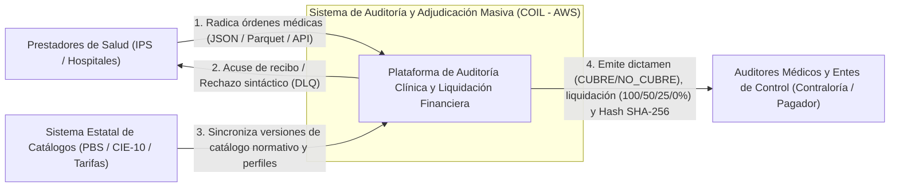
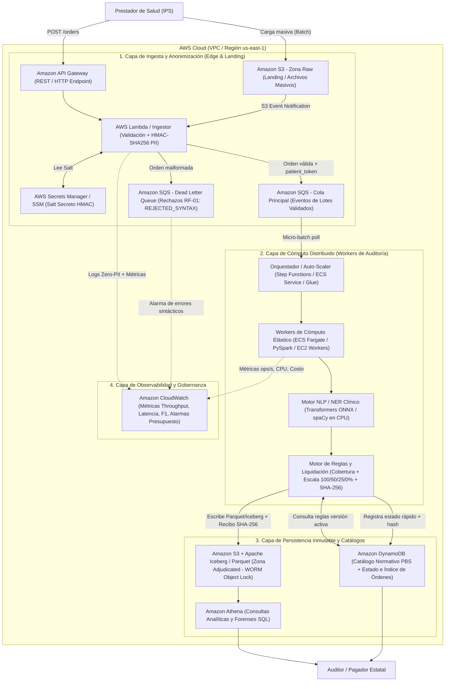
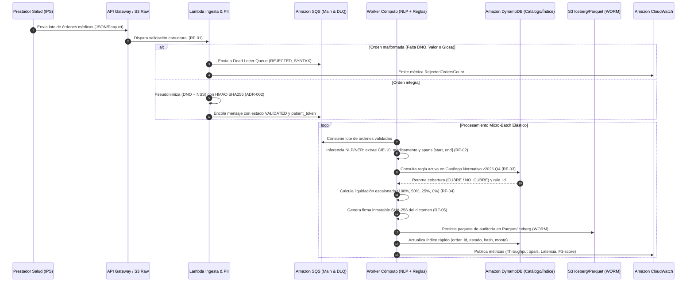

# Diseño de Arquitectura Técnica y Diagrama de Componentes (AWS)
**Proyecto:** Arquitectura Distribuida en AWS para Auditoría y Adjudicación Financiera Masiva de Órdenes Médicas (Proyecto COIL - Pagador Estatal)  
**Fase AI-DLC:** Inception / Elaboration  
**Versión:** 1.0.0  
**Alineación ADR:** ADR-001 (Híbrida Desacoplada), ADR-002 (PII HMAC-SHA256 & Trazabilidad SHA-256), ADR-003 (MVP Learner Lab vs. Producción 12M)

---

## 1. Visión Arquitectónica General

La arquitectura implementa un patrón **Híbrido Desacoplado Orientado a Eventos y Micro-lotes (Event-Driven Micro-Batching)** sobre AWS. Este diseño separa físicamente la **recepción síncrona/continua** de alta disponibilidad (24/7) del **procesamiento analítico intensivo** (inferencia NLP/NER, cruce normativo y liquidación financiera), garantizando:

1. **Absorción de Picos sin Pérdida de Datos:** Amortiguación mediante almacenamiento crudo en Amazon S3 y colas gestionadas en Amazon SQS con Dead Letter Queues (DLQ).
2. **Privacidad por Diseño (Zero-PII en Capa Analítica):** Pseudonimización inmediata en el borde de ingesta (`HMAC-SHA256` sobre `DNO` + `NSS`) antes de persistir en el Data Lake analítico o emitir logs.
3. **Eficiencia Económica ($\ge 70\%$ de ahorro):** Vectorización de inferencia clínica en micro-lotes sobre workers elásticos en CPU/ONNX, apagando el cómputo cuando las colas están vacías.
4. **Inmutabilidad Jurídica:** Generación de un recibo criptográfico `SHA-256` encadenado a los *spans* de caracteres `[start_char, end_char]` de la glosa médica, persistido en tablas columnares Apache Parquet / Apache Iceberg sobre S3 (WORM) e indexado en Amazon DynamoDB.

---

## 2. Modelo C4 — Nivel 1: Diagrama de Contexto del Sistema

Muestra cómo el **Sistema de Auditoría y Adjudicación COIL** interactúa con los actores externos y sistemas gubernamentales.



**Descripción Textual de Respaldo (Fallback C4 Nivel 1):**
* **Entradas:** Los *Prestadores de Salud (IPS)* envían órdenes médicas individuales o masivas (con `DNO`, `NSS`, `Medio Emisor`, `Valor`, `Perfil Usuario` y `Glosa Médica`). El *Sistema Estatal de Catálogos* provee las reglas vigentes (PBS, códigos CIE-10/11 y tarifas).
* **Sistema Central:** Procesa, anonimiza, extrae entidades clínicas con NLP, dictamina cobertura y liquida el monto a girar.
* **Salidas:** Notifica rechazos de estructura a las IPS y entrega a los *Auditores y Entes de Control* los paquetes de adjudicación inmutables con firma `SHA-256` y trazabilidad de texto.

---

## 3. Modelo C4 — Nivel 2: Diagrama de Contenedores en AWS

Representa los servicios y contenedores tecnológicos de AWS que conforman la arquitectura de extremo a extremo.



**Descripción Textual de Respaldo (Fallback C4 Nivel 2):**
1. **Capa de Ingesta:** Las órdenes entran por `Amazon API Gateway` (flujo continuo) o carga directa a `Amazon S3 Raw` (flujo masivo). Una función `AWS Lambda` valida el esquema (`RF-01`), consulta el salt en `Secrets Manager/SSM` y reemplaza el `DNO` y `NSS` por un `patient_token` mediante `HMAC-SHA256` (`ADR-002`). Los registros válidos pasan a `Amazon SQS` y los inválidos a la `DLQ`.
2. **Capa de Cómputo:** Los `Workers de Cómputo` (contenedores `ECS Fargate`, `AWS Glue` o procesos `PySpark` en `EC2`) consumen micro-lotes desde `SQS`, ejecutan la extracción clínica `NER` con spans `[start, end]` (`RF-02`), cruzan contra el catálogo (`RF-03`), calculan la liquidación (`RF-04`) y firman con `SHA-256` (`RF-05`).
3. **Capa de Datos:** `Amazon DynamoDB` almacena el catálogo normativo versionado en baja latencia y el índice de auditoría por `order_id`. `Amazon S3` (con formato columnar `Parquet` / tablas `Apache Iceberg` y `Object Lock WORM`) guarda el historial inmutable de adjudicaciones consultable vía `Amazon Athena`.
4. **Observabilidad:** `Amazon CloudWatch` centraliza logs sin PII, métricas de throughput ($\text{órdenes/s}$) y alarmas de consumo presupuestario.

---

## 4. Modelo C4 — Nivel 3: Diagrama de Componentes Internos del Worker de Auditoría

Detalla la arquitectura modular interna de cada **Worker de Cómputo** para cumplir los requisitos funcionales `RF-01` a `RF-05`.

```mermaid
flowchart LR
    subgraph WORKER_NODE["Contenedor / Nodo Worker de Procesamiento Masivo"]
        B_READER["1. Micro-Batch Consumer (Lector SQS / S3 Raw)"]
        PII_GUARD["2. Guardián Zero-PII (Sanitizador de Glosa y Verificador HMAC)"]
        NER_ENGINE["3. Motor Clínico NLP/NER (Extracción CIE-10, Posología y Spans)"]
        CONF_GATE["4. Compuerta de Confianza ( Validador Confidence >= 0.70 / 0.90 )"]
        RULE_MATCHER["5. Evaluador Normativo PBS (Cruce Diagnóstico vs Medicamento)"]
        FIN_CALC["6. Liquidador Financiero (Escala Cat A:100%, B:50%, C:25%, Excl:0%)"]
        CRYPTO_SIGN["7. Firmador Criptográfico (Generador Hash SHA-256 Inmutable)"]
        SINK_WRITER["8. Escritor Transaccional (Parquet/Iceberg Writer + DynamoDB Batch)"]
    end

    SQS_IN["Amazon SQS / S3 Raw"] --> B_READER
    B_READER --> PII_GUARD
    PII_GUARD --> NER_ENGINE
    NER_ENGINE --> CONF_GATE
    CONF_GATE -->|"Confianza >= Umbral"| RULE_MATCHER
    CONF_GATE -->|"Confianza < 0.70 (RF-02)"| FIN_CALC
    RULE_MATCHER --> FIN_CALC
    FIN_CALC --> CRYPTO_SIGN
    CRYPTO_SIGN --> SINK_WRITER
    SINK_WRITER --> S3_OUT["S3 Iceberg/Parquet + DynamoDB"]
```



**Descripción Textual de Respaldo (Fallback C4 Nivel 3):**
Cada worker ejecuta una tubería en memoria altamente vectorizada compuesta por 8 módulos desacoplados:
1. `Micro-Batch Consumer`: Agrupa entre 1.000 y 10.000 órdenes por lote para maximizar el throughput de CPU/ONNX.
2. `Guardián Zero-PII`: Verifica que el `DNO` ya venga tokenizado (`HMAC-SHA256`) y enmascara posibles nombres propios remanentes en la glosa sin alterar los offsets de caracteres clínicos.
3. `Motor Clínico NLP/NER`: Extrae edad, diagnóstico (`CIE-10`), medicamento y posología junto con sus coordenadas exactas `[start_char, end_char]`.
4. `Compuerta de Confianza`: Si el `confidence_score < 0.70`, etiqueta la orden con `AUDIT_FLAG_CLINICAL_UNCERTAINTY` para auditoría médica de segunda línea.
5. `Evaluador Normativo PBS`: Cruza `( código CIE-10, principio activo, nivel IPS )` contra el catálogo vigente cargado en memoria/caché desde DynamoDB, emitiendo `CUBRE` o `NO_CUBRE`.
6. `Liquidador Financiero`: Aplica la matriz escalonada según el perfil del afiliado (`CATEGORIA_A` = 100%, `CATEGORIA_B` = 50%, `CATEGORIA_C` = 25%, `NO_ASEGURADO` o `NO_CUBRE` = 0%).
7. `Firmador Criptográfico`: Calcula el `adjudication_hash = SHA256(order_id + catalog_version + rule_ids + text_spans + approved_amount)`.
8. `Escritor Transaccional`: Vuelca el lote procesado en archivos `Parquet` particionados sobre S3 (`Apache Iceberg`) y actualiza el resumen en `DynamoDB`.

---

## 5. Flujo Secuencial de Extremo a Extremo (End-to-End Flow)



**Descripción Textual de Respaldo (Fallback Secuencia):**
El flujo inicia con la radicación desde la IPS hacia `API Gateway` o `S3`. El componente de ingesta filtra errores sintácticos hacia la `DLQ` y aplica `HMAC-SHA256` sobre el `DNO` para las órdenes válidas antes de encolarlas en `SQS`. Los workers consumen lotes de `SQS`, ejecutan extracción `NER` con posiciones de caracteres, consultan el catálogo en `DynamoDB`, calculan el monto según la categoría del paciente, firman el resultado con `SHA-256` y persisten tanto el detalle columnar en `S3 (Parquet/Iceberg)` como el estado indexado en `DynamoDB`, reportando telemetría continua a `CloudWatch`.

---

## 6. Mapeo Dual de Servicios AWS: Prototipo Learner Lab vs. Producción (12M)

Siguiendo el **ADR-003**, cada componente arquitectónico mantiene exactamente el mismo contrato de interfaces, adaptando su dimensionamiento a las restricciones del **AWS Academy Learner Lab** ($100 USD máximo, cuotas limitadas de vCPU e IAM restringido):

| Capa Arquitectónica | Servicio en Producción (Licitación 12M órdenes / < 24h) | Implementación en Prototipo MVP (AWS Learner Lab 100k–1M) | Requisitos que Cumple |
| :--- | :--- | :--- | :--- |
| **1. Entrada y API** | `Amazon API Gateway` (HTTP API) + `S3 Transfer Acceleration` para cargas masivas de IPS. | `Amazon API Gateway` + `Amazon S3` (Bucket estándar con prefijo `raw/`). | **RF-01**, **RNF-01** |
| **2. Amortiguación y DLQ** | `Amazon SQS` (Standard/FIFO distribuido) + `SQS Dead Letter Queue` + `EventBridge`. | `Amazon SQS` (Cola Principal + Cola `DLQ` configurada con `maxReceiveCount = 3`). | **RF-01**, **RNF-06** |
| **3. Custodia de Salt PII** | `AWS Secrets Manager` con rotación automática de claves `KMS`. | `AWS Systems Manager Parameter Store (SecureString)` / `Secrets Manager` para el salt de `HMAC-SHA256`. | **RNF-05**, **ADR-002** |
| **4. Workers de Cómputo y NLP** | Clúster auto-escalable en `Amazon ECS Fargate` (Graviton3 Spot) + `AWS Glue / EMR Serverless (PySpark)` ejecutando modelos NER en `ONNX Runtime`. | Contenedores `ECS Fargate` / instancias `EC2 (t3.medium / c6i.large)` con workers multiproceso Python / PySpark y modelo NER ligero cuantizado en CPU (`spaCy` / `ONNX`). | **RF-02**, **RNF-01**, **RNF-02**, **RNF-03** |
| **5. Catálogo e Índice Operacional** | `Amazon DynamoDB` (On-Demand con DAX caché en memoria para lectura de reglas y escritura de estados). | `Amazon DynamoDB` (Capacidad On-Demand / Provisioned acotada con caché LRU en memoria del worker para ahorrar RCUs). | **RF-03**, **RF-04**, **RNF-03** |
| **6. Data Lakehouse Inmutable** | `Amazon S3` + `Apache Iceberg` (registrado en `AWS Glue Data Catalog`) con `S3 Object Lock (Modo Compliance WORM)`. | `Amazon S3` con particionamiento columnar `Apache Parquet` (compresión Snappy) / tabla `Iceberg` + `S3 Versioning & Object Lock`. | **RF-05**, **RNF-04** |
| **7. Observabilidad y Costos** | `Amazon CloudWatch` (Custom Metrics, Dashboards, Container Insights) + `AWS Cost Anomaly Detection`. | `Amazon CloudWatch` (Logs estructurados JSON sin PII, métricas custom de `Throughput`, `Latency` y `AWS Budgets` alerta a \$50/\$80 USD). | **RNF-01**, **RNF-03**, **RNF-05** |

---

## 7. Diseño de Esquemas de Datos y Almacenamiento

### 7.1 Estructura de Particionamiento en Amazon S3 (Data Lakehouse)
```text
s3://coil-medical-audit-datalake-{env}/
├── raw/                                  # Zona de aterrizaje (Retención temporal corta / acceso restringido)
│   └── ingestion_date=YYYY-MM-DD/
├── rejected/                             # Espejo persistente de la DLQ para conciliación con IPS
│   └── ingestion_date=YYYY-MM-DD/
└── adjudicated/                          # Tabla Apache Iceberg / Parquet (WORM Inmutable, Zero-PII)
    ├── metadata/                         # Snapshots transaccionales de Iceberg
    └── data/
        └── catalog_version=2026.Q4/
            └── decision_date=YYYY-MM-DD/
                └── status=APPROVED|REJECTED_COVERAGE|FLAGGED/
                    └── part-0001.snappy.parquet
```

### 7.2 Diseño de Tablas en Amazon DynamoDB

1. **Tabla `COIL-NormativeCatalog` (Catálogo PBS y Reglas de Cobertura):**
   * **Partition Key (`PK`):** `CATALOG#<catalog_version>` (ej. `CATALOG#2026.Q4`)
   * **Sort Key (`SK`):** `CIE10#<cie10_code>#MED#<normalized_med_code>` (ej. `CIE10#I10#MED#LOSARTAN_50MG`)
   * **Atributos:** `coverage_status` (`CUBRE` | `NO_CUBRE`), `rule_id` (`RULE-PBS-CARDIO-104-v2026.4`), `max_tariff_cop`, `allowed_ips_levels` (`[1,2,3,4]`).
   * **Optimización de Costos:** Los workers cargan la versión activa del catálogo en un diccionario en memoria al iniciar el micro-batch, reduciendo en un **99%** las lecturas repetitivas a DynamoDB durante el procesamiento de millones de órdenes.

2. **Tabla `COIL-OrderAuditIndex` (Índice de Consulta Rápida y Verificación de Integridad):**
   * **Partition Key (`PK`):** `ORDER#<order_id>` (ej. `ORDER#ORD-2026-9001`)
   * **Sort Key (`SK`):** `AUDIT#<timestamp_iso>`
   * **GSI-1 (`PatientTokenIndex`):** `PK = patient_token` (`HMAC-SHA256`), `SK = timestamp_iso` (permite auditar el historial de un paciente sin conocer su `DNO` real).
   * **Atributos Clave:**
     * `patient_token`: Hash `HMAC-SHA256(DNO + NSS, secret_salt)`
     * `emitter_ips_code`: Código de habilitación de la IPS
     * `user_category`: `CATEGORIA_A` | `CATEGORIA_B` | `CATEGORIA_C` | `NO_ASEGURADO`
     * `coverage_dictamen`: `CUBRE` | `NO_CUBRE` | `AUDIT_FLAG_CLINICAL_UNCERTAINTY`
     * `applied_rules`: Lista de IDs de reglas aplicadas
     * `text_spans`: JSON con entidades y coordenadas `[{"entity": "I10", "start": 112, "end": 133}, ...]`
     * `claimed_amount`: Valor reclamado original
     * `approved_percentage`: `100` | `50` | `25` | `0`
     * `approved_amount`: Monto final liquidado a girar
     * `adjudication_hash`: Firma `SHA-256` inmutable
     * `s3_parquet_uri`: Ruta al bloque Parquet/Iceberg con el registro forense completo

---

## 8. Observabilidad y Métricas en Amazon CloudWatch

Para certificar el cumplimiento de los Requisitos No Funcionales (`RNF-01` a `RNF-06`) ante el jurado de licitación, los workers emiten métricas personalizadas en el namespace `COIL/MedicalAudit`:

* `OrdersProcessedPerSecond` (Unidad: `Count/Second`): Certifica la tasa de $\ge 100\text{–}300\text{ órdenes/s}$ en el prototipo y su extrapolación lineal a $1.111\text{ órdenes/s}$.
* `BatchProcessingLatencyMs` (Unidad: `Milliseconds`): Tiempo de procesamiento por micro-lote desglosado por etapa (`PII_Masking`, `NLP_Inference`, `Rule_Evaluation`, `Crypto_Signing`).
* `NLPConfidenceScore` (Unidad: `None`): Distribución estadística de certeza del modelo NER y conteo de órdenes enviadas a segunda línea (`ClinicalUncertaintyFlags`).
* `SyntaxRejectionCount` (Unidad: `Count`): Volumen de órdenes desviadas a la `DLQ` por incumplimiento del esquema (`RF-01`).
* `ZeroPIIViolationAlert` (Unidad: `Count`): Sensor de seguridad que verifica mediante expresiones regulares que ningún log ni métrica contenga patrones de `DNO` sin anonimizar (debe mantenerse estrictamente en `0`).
