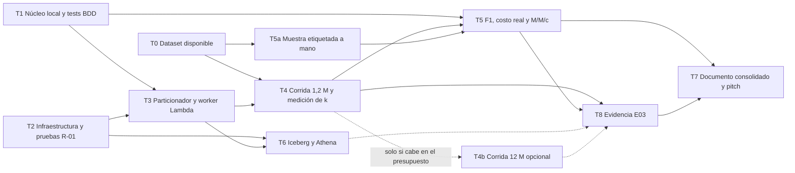

# Plan de construcción del prototipo

| Campo | Valor |
| :--- | :--- |
| Paso AI-DLC | 4, Plan |
| Entregable que alimenta | E03 Implementación |
| Estado | Borrador para revisión del equipo |
| Fuentes | [RF](../inception/01_requisitos_funcionales_bdd.md), [RNF](../inception/02_requisitos_no_funcionales.md), [ADR-001](../inception/adrs/ADR-001-estrategia-procesamiento.md), [ADR-002](../inception/adrs/ADR-002-anonimizacion-pii-y-trazabilidad.md), [ADR-003](../inception/adrs/ADR-003-estrategia-mvp-lab-aws.md), [ADR-004](../design/adrs/ADR-004-computo-workers-lambda.md), [ADR-005](../design/adrs/ADR-005-almacenamiento-poliglota.md), [arquitectura técnica](../design/03_arquitectura_tecnica.md), [enunciado](../enunciado/TrabajoFinal.pdf) |

Este plan solo usa lo que ya está decidido en los RF, los RNF y los ADR. No agrega servicios ni metas nuevas. Lo que no se puede verificar en el repositorio aparece como pendiente, y las contradicciones entre documentos quedan en la sección 7 como preguntas para el equipo.

## 1. Alcance del prototipo en el Learner Lab

ADR-003 fija que el prototipo procesa las 1.200.000 solicitudes del dataset oficial con servicios serverless compatibles con `LabRole` y un presupuesto de 50 USD, y que la escala de 12 M se sustenta con el modelo M/M/c alimentado con el `k` medido. El alcance sigue esa decisión.

### 1.1 Lo que se implementa

| Componente | Servicio | Requisitos | Fuente |
| :--- | :--- | :--- | :--- |
| Núcleo de adjudicación (validación, pseudonimización con `#`, extracción con spans, cobertura, liquidación con `Decimal`, hash SHA-256) | Librería Python, probada en local y empaquetada para Lambda | RF-01 a RF-05, RNF-04, RNF-05 | Arquitectura sección 5, ADR-002, ADR-004 |
| Zonas de datos `saom-raw`, `saom-ref`, `saom-curated` y `saom-audit` | S3 | RNF-04, RNF-05 | Arquitectura sección 7.1, ADR-005 |
| Colas `lotes-recibidos` y `chunks-adjudicacion` con DLQ y `maxReceiveCount` 3 | SQS | RF-01, RNF-06 | Arquitectura secciones 4 y 8.2 |
| Control de lotes y chunks con idempotencia | DynamoDB on-demand, tabla `control_lotes` | RNF-06 | Arquitectura sección 7.2, ADR-005 |
| Particionador por rangos de bytes de 5.000 filas | Lambda | RF-01 | Arquitectura sección 6.1 |
| Worker de adjudicación con concurrencia de 5 a 10 | Lambda Arm, imagen de contenedor o ZIP según R-01 | RF-01 a RF-05, RNF-06 | ADR-004, arquitectura sección 14 |
| Clave secreta HMAC con `key_version` | Secrets Manager o variable cifrada con KMS | RNF-05 | Arquitectura sección 10 |
| Recibos y manifiestos inmutables | S3 con Object Lock, o Versioning con política que niega el borrado si `LabRole` no lo permite | RF-05, RNF-04 | ADR-003, ADR-005 |
| Telemetría de throughput, rechazos y DLQ | CloudWatch Logs y métricas EMF | RNF-01 | Arquitectura sección 4 |
| Tabla `adjudicaciones` y consultas SQL (prioridad media) | Iceberg sobre S3, Glue Data Catalog y Athena | RNF-04 | ADR-005 |

### 1.2 Lo que queda solo en diseño

| Elemento del diseño | Qué se hace en el prototipo | Justificación del recorte |
| :--- | :--- | :--- |
| API de radicación con API Gateway, URL prefirmada y `GET /lotes/id` | El CSV se sube directo a `saom-raw` desde la consola o la CLI | La cadena que miden los RNF empieza en el evento `ObjectCreated`. La API no cambia el throughput, la trazabilidad ni la privacidad, y en el diseño su costo es marginal (arquitectura sección 11.1) |
| Consolidación cada 15 minutos con EventBridge Scheduler y Step Functions | Una sola consolidación al terminar los 240 chunks | La sección 12 de la arquitectura ya prevé este disparo para el Learner Lab. La pregunta P-10 pide confirmarlo porque ADR-003 nombra Step Functions |
| `OPTIMIZE` diario y expiración de snapshots de Iceberg | No se ejecutan | Con una sola corrida no se acumulan archivos pequeños ni snapshots que mantener |
| Object Lock en modo `COMPLIANCE` | Solo si T2 confirma que `LabRole` lo permite | ADR-003 y ADR-005 definen la alternativa con Versioning, negación de borrado y cadena de hashes |
| Un rol IAM de mínimo privilegio por función | Todo corre con `LabRole` | El laboratorio no permite crear roles (arquitectura sección 10) |
| Claves KMS administradas por el cliente, AWS WAF y API key por entidad | Clave administrada por AWS, sin WAF ni API key | Dependen de la API de radicación o de permisos que el laboratorio no da (arquitectura sección 10) |
| Ciclo de vida a Glacier a los 30 días | No se configura | El prototipo no dura 30 días con datos y la regla no afecta ningún RNF medible |
| Padrón externo de afiliación en DynamoDB | No se implementa | El diseño lo marca como opcional, porque el perfil viene en la glosa (ADR-005) |
| Portabilidad del worker a ECS Fargate Spot | No se prueba | ADR-004 la deja como salida futura, y ECS y Fargate se reportan como no disponibles en el laboratorio |
| Concurrencia de hasta 56 workers y volumen de 12 M diarios | Concurrencia máxima de 10 y 1,2 M de órdenes, con extrapolación M/M/c | ADR-003 y RNF-06. La corrida de 12 M solo se hace como T4b opcional |
| Flujo de revisión humana de segunda línea | Solo se marca el flag `AUDIT_FLAG_CLINICAL_UNCERTAINTY` | RF-02 exige marcar la orden para revisión, y ningún RF especifica la herramienta de revisión |
| Rotación de la clave HMAC | Se registra `key_version`, sin rotar | La rotación es una mitigación de operación (arquitectura sección 14, R-05) |

## 2. Tareas

Todas las tareas tienen responsable por asignar. Las tareas T0, T5a y T8 no estaban en la lista mínima. Se agregan porque otras tareas dependen de ellas.

| ID | Tarea | Depende de | MoSCoW | Criterio de terminado verificable | Responsable |
| :--- | :--- | :--- | :--- | :--- | :--- |
| T0 | Obtener el dataset `COIL_dataset_glosas_salud_1_2M.csv` y fijar su ubicación local fuera de git | Ninguna | Must | El archivo existe en la ruta acordada, tiene 1.200.000 filas más la cabecera de 6 columnas de RF-01 y su SHA-256 queda anotado en la bitácora | Por asignar |
| T1 | Núcleo local en Python con validación, pseudonimización con `#`, extracción con spans, cobertura, liquidación con `Decimal` y hash SHA-256 | Ninguna | Must | Hay un test por cada escenario BDD de RF-01 a RF-05 y todos pasan en local. Para cada entidad clínica extraída se cumple que el texto en `[start_char, end_char]` coincide en la glosa original y en la enmascarada. La liquidación no usa `float`. Cambiar un centavo o un carácter del JSON canónico cambia el `hash_decision`. El escaneo de PII de RNF-05 sobre las salidas de los tests da cero coincidencias | Por asignar |
| T2 | Infraestructura en el Learner Lab con buckets, SQS con DLQ y DynamoDB, más las pruebas tempranas de R-01. Se hace en paralelo con T1 | Ninguna | Must | Los recursos de la sección 1.1 existen en `us-east-1`. Queda escrito en `docs/verificacion/` el resultado de cada prueba de R-01 con su evidencia, es decir Object Lock, ECR, límite de concurrencia de Lambda, Glue Data Catalog, Secrets Manager y la forma de consultar el costo consumido. No queda ningún recurso con costo fijo por hora. El procedimiento de apagado está documentado | Por asignar |
| T3 | Particionador y worker Lambda | T1, T2 | Must | Un CSV de prueba con varios chunks y una fila malformada recorre la cadena completa en AWS. Al final `chunks_completados` es igual a `chunks_totales`, la fila malformada está en `rechazos/`, la DLQ está vacía y reenviar un mensaje ya procesado no cambia los contadores de `META` (RNF-06) | Por asignar |
| T4 | Corrida con el dataset de 1,2 M y medición del throughput real `k` | T0, T3 | Must | Los 240 chunks terminan. `ordenes_validas` más `ordenes_rechazadas` suman 1.200.000. Cada mensaje que llegue a la DLQ tiene una causa anotada. El 100 % de las órdenes válidas tiene `hash_decision` y existen la `raiz_hash_chunk` de cada chunk y la `raiz_hash_lote`. El `k` medido sale de las métricas de CloudWatch con el método escrito. El escaneo de PII de RNF-05 sobre `saom-curated`, `saom-audit`, DynamoDB y los logs da cero coincidencias | Por asignar |
| T4b | Corrida opcional de 12 M con el dataset replicado e ids nuevos | T4 | Could | Antes de correr queda en la bitácora la decisión con tres datos, que son el costo estimado con `modelo_capacidad_costo.py` y el `k` de T4, el saldo real del laboratorio y el margen de holgura que acuerde el equipo (pendiente). Si se corre, cumple los mismos criterios de T4 escalados a 12 M | Por asignar |
| T5a | Muestra etiquetada a mano para medir F1 | T0 | Must | Existe una muestra con etiquetas de `Edad`, `PerfilCobertura`, `ServicioSolicitado` y `Medicacion` y sus spans, hechas por personas sin usar la salida del extractor. El tamaño de la muestra, el protocolo de etiquetado y el criterio de coincidencia de spans quedan definidos (pendiente) | Por asignar |
| T5 | Métricas, es decir F1 contra la muestra, costo real y extrapolación M/M/c con el `k` medido | T1, T4, T5a | Must | Hay un informe en `docs/verificacion/` con precision, recall y F1 por entidad y macro F1 frente a la meta de RNF-02. Incluye el costo real de la corrida según la fuente que confirme T2 frente al estimado de la arquitectura (sección 11.3), la fracción `f` de órdenes marcadas para revisión frente al umbral de RNF-03, y `N`, `rho` y `Wq` para 12 M recalculados con el `k` medido | Por asignar |
| T6 | Consolidación en Iceberg y consultas en Athena | T2, T3 | Should | El `MERGE INTO` deja en `adjudicaciones` tantas filas como órdenes válidas. Repetir el `MERGE` no agrega filas. Hay consultas guardadas de monto aprobado por `entidad_emisora`, `medio_emisor` y día (ADR-005). Para una muestra de órdenes se repite la verificación de tres niveles de la arquitectura (sección 7.4) desde la fila de Iceberg | Por asignar |
| T8 | Paquete de evidencia del E03 | T4, T5, T6 si se hizo | Must | Están todos los elementos de la sección 5 con enlace a su archivo en `entregables/E03/` o en `docs/verificacion/` | Por asignar |
| T7 | Documento consolidado y pitch del E04 | T5, T8 | Must | Están el documento consolidado y el material del pitch en `entregables/E04/`. El equipo decidió qué correcciones de [correcciones_E01.md](correcciones_E01.md) se incorporan. El formato y la fecha están pendientes porque el enunciado no los fija | Por asignar |

La ruta crítica es T1 y T2 en paralelo, luego T3, T4, T5, T8 y T7. T0 tiene que estar listo antes de que termine T3 para no frenar T4, y T5a puede avanzar en paralelo con T1, T2 y T3.

## 3. Grafo de dependencias



Versión en texto del grafo. Las flechas con puntos (`..>`) son dependencias opcionales.

```
T0  --> T4, T5a
T1  --> T3, T5
T2  --> T3, T6
T3  --> T4, T6
T4  --> T5, T8
T4  ..> T4b   (solo si cabe en el presupuesto)
T5a --> T5
T5  --> T8, T7
T6  ..> T8    (Should)
T4b ..> T8    (Could)
T8  --> T7
```

## 4. Condición para correr T4b

El diseño calcula el costo de cómputo del prototipo de 1,2 M en 0,07 USD con `k` de 400, 0,28 USD con `k` de 100 y 1,13 USD con `k` de 25 (arquitectura sección 11.3). El modelo de cómputo de `modelo_capacidad_costo.py` es lineal en el número de órdenes, así que 12 M cuestan diez veces eso en cómputo. Ese cálculo no incluye S3, SQS, DynamoDB, CloudWatch ni Athena, que hay que sumar.

T4b solo se corre si se cumplen tres condiciones, y la decisión queda en la bitácora.

1. El `k` medido en T4 está disponible.
2. Se conoce el saldo real del laboratorio en ese momento (pendiente, la forma de consultarlo sale de T2).
3. El costo estimado deja el margen de holgura que acuerde el equipo (pendiente).

Además el formato de `id_solicitud` del ejemplo de RF-01 tiene siete dígitos, y eso no alcanza para 12 M de ids únicos (pregunta P-13).

## 5. Evidencia que pide la rúbrica del E03

El enunciado describe el E03 como "Prototipo funcional en AWS, pruebas, evidencia y alcance implementado", con producto "Código y resultados". La rúbrica evalúa "Prototipo funcional, uso pertinente de AWS y evidencia de pruebas". El enunciado no detalla formato ni contenido mínimo. La columna de evidencia es una propuesta del equipo para cubrir cada criterio.

| Criterio del enunciado | Evidencia propuesta | Tarea |
| :--- | :--- | :--- |
| Prototipo funcional | Registro de la corrida de 1,2 M con los conteos de `control_lotes`, la DLQ vacía o con causas anotadas y la `raiz_hash_lote` | T4 |
| Uso pertinente de AWS | Inventario de recursos creados frente a la sección 1.1, resultado de las pruebas de R-01 y relación de cada recorte de la sección 1.2 con su justificación | T2, T8 |
| Evidencia de pruebas | Salida de los tests BDD de RF-01 a RF-05, prueba de idempotencia de T3, escaneo de PII de RNF-05 y verificación de tres niveles de RNF-04 | T1, T3, T4, T6 |
| Resultados | Informe de T5 con `k`, F1 por entidad, costo real, fracción `f` de revisión y dimensionamiento M/M/c para 12 M | T5 |
| Código | Código del núcleo, del particionador y del worker con su versión en git | T1, T3 |
| Alcance implementado | Tabla final de lo implementado y lo que quedó solo en diseño, actualizada desde la sección 1 | T8 |

## 6. Riesgos que afectan el plan

| Riesgo | Efecto en el plan | Tarea que lo cierra |
| :--- | :--- | :--- |
| R-01, permisos de `LabRole` sobre Object Lock, ECR y concurrencia de Lambda | Cambia el empaquetado del worker y el mecanismo WORM | T2 |
| R-02, el `k` real define `N` y el costo | Cambia la extrapolación y la decisión de T4b | T4 |
| Dataset no disponible (pendiente, el equipo confirmará de dónde se obtiene) | Bloquea T4 y T5a | T0 |
| Disponibilidad de Glue Data Catalog en el laboratorio | Bloquea T6 | T2 |
| Saldo real del laboratorio desconocido | Bloquea la decisión de T4b | T2 |

## 7. Preguntas para el equipo

Son contradicciones o vacíos entre los documentos. El plan no las resuelve.

| ID | Documentos | Contradicción o vacío |
| :--- | :--- | :--- |
| P-01 | RF-02 | El escenario dice que la glosa de `CHV-0000001` tiene 238 caracteres, pero el texto del propio escenario mide 235 caracteres (239 bytes en UTF-8). ¿Se corrige la cifra o el texto del ejemplo no es el del dataset? |
| P-02 | RF-01 y RF-04 | RF-01 usa `CHV-0000002` como fila malformada y RF-04 la usa como orden válida de "Suministro de antihipertensivos". ¿Cuál corresponde al dataset? |
| P-03 | RF-03 y arquitectura sección 7.3 | RF-03 pide verificar el rango de valor y las medicaciones de referencia, pero no dice qué pasa si no se cumplen. La arquitectura sugiere el flag `VALOR_FUERA_RANGO_REF`. ¿Solo se marca o cambia el dictamen? ¿Y si la medicación no está en `medicaciones_referencia`? |
| P-04 | RF-02 | Se exige confianza mayor o igual a 0,92 y se marca revisión por debajo de 0,70. No está definido qué pasa entre 0,70 y 0,92 ni cómo se calcula la confianza en un extractor léxico |
| P-05 | RNF-02 | Dice que el F1 se evalúa "sobre el dataset oficial", que no trae etiquetas de referencia. El plan propone una muestra etiquetada a mano (T5a). Falta confirmar tamaño y protocolo |
| P-06 | RNF sección 3, RNF-03, ADR-003, arquitectura secciones 2 y 11.3 | El costo de una corrida de 1,2 M aparece como menor a 0,35 USD, menor a 0,30 USD y hasta 1,13 USD según `k`. RNF-03 pide 0,50 USD o menos por millón en el laboratorio y su criterio de aceptación habla de 0,25 a 0,31 USD por millón. ¿Cuál es la meta? |
| P-07 | Arquitectura secciones 8.1 y 14 | La sección 8.1 afirma que el extractor supera fácilmente un `k` de 400, y R-02 dice que `k` se mide. ¿Se trata como hipótesis hasta T4? |
| P-08 | ADR-004 y ADR-005 | ADR-004 dice que la documentación del laboratorio no lista Glue, y ADR-005 usa Glue Data Catalog para Iceberg |
| P-09 | ADR-002 y arquitectura sección 7.4 | ADR-002 habla de "árbol de hashes" y de hashes que "se encadenan". La arquitectura define la raíz como SHA-256 de la concatenación ordenada, que es una lista plana y no un árbol de Merkle. ¿Qué algoritmo se implementa? |
| P-10 | ADR-003 y arquitectura sección 12 | ADR-003 incluye Step Functions entre los servicios del prototipo. La arquitectura permite consolidar al completar los 240 chunks sin Step Functions |
| P-11 | ADR-004, ADR-005, `aidlc/.../project.md` y git | ADR-004 y ADR-005 tienen fecha 2026-10-21, entraron al repositorio en 148cf96 el 2026-10-22 y `project.md` los registra como decididos el 2026-10-27. `project.md` también fecha ADR-002 el 2026-10-27, y el ADR dice 2026-10-21 |
| P-12 | Arquitectura, ADR-004 y ADR-005 | Se rotulan como fase "Construction", y el README los trata como paso 3 Arquitectura |
| P-13 | RF-01 y T4b | El ejemplo `CHV-0000001` tiene siete dígitos, con un máximo de 9.999.999 ids. Para 12 M hace falta otro formato y que el validador lo acepte |
| P-14 | RF-04 y arquitectura sección 7.3 | RF-04 y la tabla Iceberg mencionan el copago (`valor_copago`), pero ninguna regla dice cómo se calcula, ni para `CUBRE` ni para `NO_CUBRE` |
| P-15 | RNF-05 y T5a | La muestra etiquetada sale de glosas con nombres e identificadores, aunque sean sintéticos. ¿Se versiona en git o se guarda fuera, como el dataset? |
| P-16 | RNF-01 | El criterio del prototipo dice "dentro del SLA", pero no define el SLA para la corrida de 1,2 M |
| P-17 | RF-04 y arquitectura sección 5 | Un perfil inválido liquida al 0 %, pero no está definido qué dictamen y qué flag lleva esa orden |
