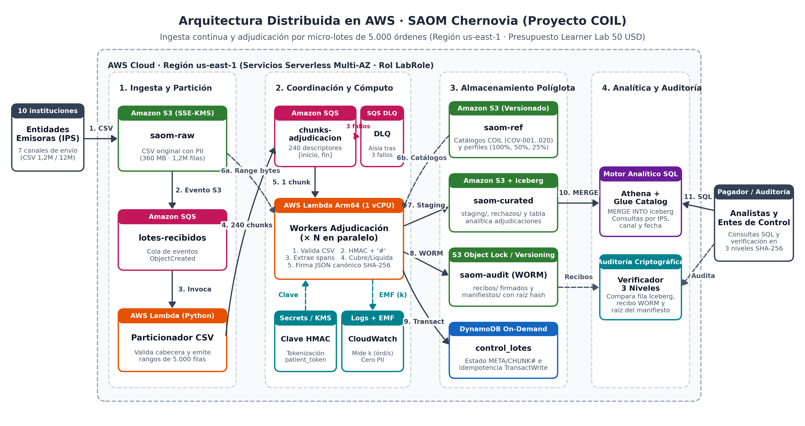
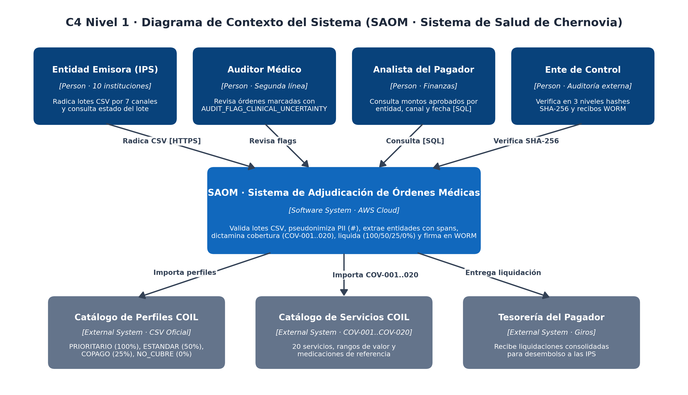
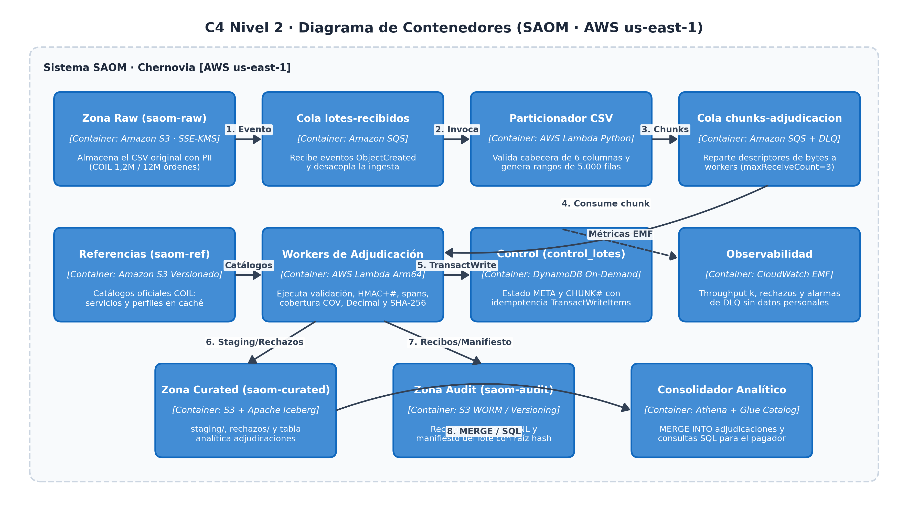
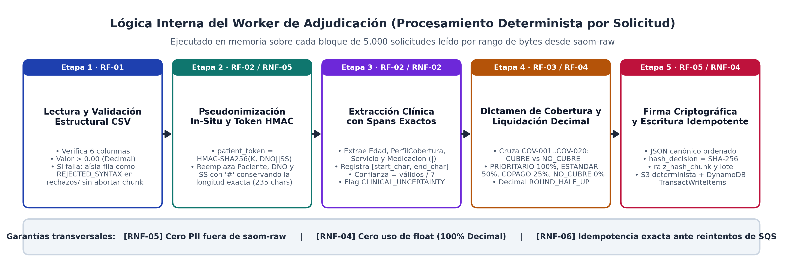
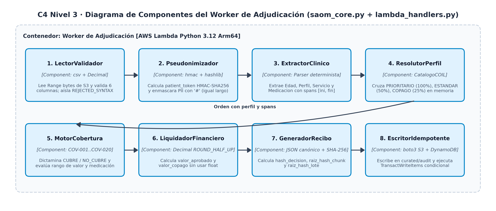

# Entregable 02: Diseño Técnico y Arquitectura Distribuida en AWS

| Campo de Control | Detalle del Entregable |
| :--- | :--- |
| **Proyecto** | Sistema de Adjudicación de Órdenes Médicas (**SAOM**) · Sistema Público de Salud de Chernovia (Proyecto COIL) |
| **Entregable** | **02 — Diseño Técnico** (25 % de la calificación del curso) |
| **Equipo** | Naomi Chow, Daniel Lopez y María Fernanda Toro |
| **Versión** | 1.0 (Alineada con el Dataset Oficial COIL de 1,2 M, ADR-001 a ADR-005 y resoluciones P-01 a P-17) |
| **Artefactos relacionados** | [`03_arquitectura_tecnica.md`](../../docs/design/03_arquitectura_tecnica.md), [`modelo_capacidad_costo.py`](../../docs/design/modelo_capacidad_costo.py), [`saom_core.py`](../../prototype/saom_core.py), [`lambda_handlers.py`](../../prototype/lambda_handlers.py) |

---

## 1. Resumen Ejecutivo de la Solución Técnica

El **Sistema de Adjudicación de Órdenes Médicas (SAOM)** es una arquitectura **cloud-native, serverless y orientada a eventos** en Amazon Web Services (`us-east-1`) que materializa la ruta híbrida del **ADR-001**. Su propósito es validar, pseudonimizar datos sensibles, extraer entidades clínicas con posiciones de caracteres (`spans`), dictaminar cobertura normativa (`COV-001` a `COV-020`), liquidar montos aprobados y copagos (`100 %`, `50 %`, `25 %` o `0 %`) y firmar criptográficamente cada decisión para un volumen objetivo de **12 millones de órdenes médicas en menos de 24 horas** (y en una ventana exigente de **3 horas** como meta del equipo).

La decisión arquitectónica que optimiza simultáneamente el rendimiento y el costo es **procesar por micro-lotes (chunks) de 5.000 solicitudes definidos por rangos exactos de bytes (`[byte_inicio, byte_fin]`)** en lugar de orquestar orden por orden. Esto reduce las operaciones de S3, SQS, DynamoDB y Lambda en un factor de $5.000\times$, logrando un costo de nube de **3,02 USD por cada 12 millones de órdenes** (**0,25 USD por millón**) y de **0,07 a 0,28 USD** para la corrida completa de **1.200.000 solicitudes** en el AWS Academy Learner Lab.

---

## 2. Arquitectura Distribuida Simplificada y Vistas C4

### 2.1. Diagrama Simplificado de Arquitectura en AWS (4 Etapas)

| Etapa | Componentes AWS | Responsabilidad en el Flujo | Requisitos / ADR |
| :--- | :--- | :--- | :--- |
| **1. Ingesta y Partición** | `S3 saom-raw` + `SQS lotes-recibidos` + `Lambda Particionador` | Custodia el CSV original con PII (SSE-KMS), valida la cabecera de 6 columnas en streaming $\mathcal{O}(1)$ y emite 240 descriptores de rangos de bytes de 5.000 filas | RF-01, RNF-05, ADR-001 |
| **2. Coordinación y Cómputo** | `SQS chunks-adjudicacion` (+ `DLQ`) + `Lambda Workers Arm64` + `Secrets/KMS` | Reparte los chunks entre $N$ workers en paralelo; cada worker lee solo su rango de bytes (`~1,5 MB`), ejecuta las 5 etapas del núcleo y emite métricas EMF ($k$) | RF-01..05, RNF-01, RNF-06, ADR-004 |
| **3. Almacenamiento Políglota** | `S3 saom-ref`, `S3 saom-curated`, `S3 saom-audit (WORM)` y `DynamoDB control_lotes` | Mantiene catálogos COIL versionados, `staging/`, `rechazos/`, recibos firmados inmutables, manifiesto del lote y control idempotente con `TransactWriteItems` | RF-04, RF-05, RNF-04, RNF-06, ADR-005 |
| **4. Analítica y Auditoría** | `Athena + Glue Data Catalog` + `Verificador 3 Niveles` | Consolida `staging/` en la tabla Iceberg `adjudicaciones` mediante `MERGE INTO`, habilita consultas SQL para giros y verifica los hashes SHA-256 en 3 niveles | RNF-01, RNF-03, RNF-04 |

### 2.2. Vistas C4 de Contexto (Nivel 1) y Contenedores (Nivel 2)

### 2.3. Justificación de las Decisiones Arquitectónicas (ADR-001 a ADR-005)

| ADR | Decisión | Alternativas Descartadas | Justificación Técnica y Económica |
| :--- | :--- | :--- | :--- |
| **[ADR-001](../../docs/inception/adrs/ADR-001-estrategia-procesamiento.md)** | Ruta híbrida con ingesta continua y micro-lotes de 5.000 órdenes | Batch monolítico nocturno; Serverless orden por orden (Step Functions + Comprehend Medical) | Procesar orden por orden multiplica por 5.000 las transiciones y llamadas de red; el micro-lote por rango de bytes mantiene baja latencia a 0,25 USD/millón |
| **[ADR-002](../../docs/inception/adrs/ADR-002-anonimizacion-pii-y-trazabilidad.md)** | `HMAC-SHA256` con clave secreta, enmascaramiento `#` de igual longitud y `SHA-256` sobre JSON canónico | Supresión de longitud variable; SHA-256 sin clave sobre el DNO | Evita ataques de diccionario sobre identificadores cortos y conserva intactos los desplazamientos `[start_char, end_char]` entre la glosa original y la enmascarada |
| **[ADR-003](../../docs/inception/adrs/ADR-003-estrategia-mvp-lab-aws.md)** | Prototipo serverless en Learner Lab (50 USD) con 1,2 M de órdenes reales y extrapolación $M/M/c$ a 12 M | Clústeres EMR permanentes o corrida de 12 M en el laboratorio | Respeta `LabRole` y el límite de 50 USD con costo fijo de 0,00 USD/hora en reposo |
| **[ADR-004](../../docs/design/adrs/ADR-004-computo-workers-lambda.md)** | Cómputo de workers en AWS Lambda Arm64 (portable a ECS Fargate Spot) | EMR / Glue PySpark para bloques de 1,5 MB | Escalado casi instantáneo por cola SQS y 20 % de ahorro en Graviton2 (Arm64) |
| **[ADR-005](../../docs/design/adrs/ADR-005-almacenamiento-poliglota.md)** | Almacenamiento políglota: DynamoDB + Apache Iceberg en S3 + S3 WORM | Base relacional única o archivos CSV/JSON sueltos sin catálogo | Asigna cada carga al servicio óptimo: transacciones condicionales en DynamoDB, SQL analítico en Iceberg/Athena e inmutabilidad probatoria en S3 WORM |

---

## 3. Lógica de Clasificación, Liquidación y Trazabilidad del Worker

| Etapa Interna | Regla Implementada en `saom_core.py` | Resolución de Casos Borde (P-01 a P-17) |
| :--- | :--- | :--- |
| **1. Validación CSV (`RF-01`)** | Verifica las 6 columnas obligatorias y `valor_procedimiento > 0.00` con `Decimal` | Filas malformadas (ej. `CHV-9999999`) se aíslan como `REJECTED_SYNTAX` en `rechazos/` sin exponer PII y sin abortar el resto del chunk (`P-02`) |
| **2. Pseudonimización (`RF-02`, `RNF-05`)** | Calcula `patient_token = HMAC-SHA256(K, DNO‖SeguroSocial)` y reemplaza `Paciente`, `DNO` y `SeguroSocial` con `#` carácter por carácter | Mantiene exactamente la misma longitud (235 caracteres en `CHV-0000001`, `P-01`), garantizando que `glosa[ini:fin] == glosa_enmascarada[ini:fin]` para toda entidad clínica |
| **3. Extracción con Spans (`RF-02`, `RNF-02`)** | Extrae `Edad`, `PerfilCobertura`, `ServicioSolicitado` y `Medicacion` (separada por `|`) con sus posiciones `[start_char, end_char]` | La confianza se calcula como `campos_validos / 7` y se almacena como dato (`P-04`). Se marca `AUDIT_FLAG_CLINICAL_UNCERTAINTY` si falta o es inválido `Edad`, `ServicioSolicitado` o `Medicacion`, o si falta `PerfilCobertura` |
| **4. Cobertura Normativa (`RF-03`)** | Cruza `ServicioSolicitado` contra `COIL_catalogo_servicios_cubiertos.csv` (`COV-001` a `COV-020`) para emitir `CUBRE` o `NO_CUBRE` | Si el valor sale del rango de referencia o una medicación no está en `medicaciones_referencia`, se agregan `AUDIT_FLAG_VALOR_FUERA_RANGO_REF` y `AUDIT_FLAG_MEDICACION_NO_REFERENCIA` sin cambiar el dictamen (`P-03`) |
| **5. Liquidación Decimal (`RF-04`)** | Aplica `PRIORITARIO = 100 %`, `ESTANDAR = 50 %`, `COPAGO = 25 %` cuando `CUBRE`, o `0 %` cuando `NO_CUBRE`, usando `Decimal` y `ROUND_HALF_UP` | Siempre `valor_copago = valor_procedimiento - valor_aprobado` (`P-14`). Un perfil escrito fuera del catálogo liquida al `0 %`, conserva el dictamen del servicio y lleva solo `AUDIT_FLAG_PERFIL_DESCONOCIDO` (`P-17`) |
| **6. Firma y Raíces (`RF-05`, `RNF-04`)** | Serializa la decisión en JSON canónico y calcula `hash_decision` (`SHA-256`) | `raiz_hash_chunk` y `raiz_hash_lote` son el `SHA-256` de la concatenación ordenada de hashes por `id_solicitud` y por `chunk_id` respectivamente (`P-09`) |

---

## 4. Dimensionamiento Matemático ($M/M/c$) y Estrategia de Costo

### 4.1. Dimensionamiento por Teoría de Colas ($M/M/c$)

| Ventana (12M órdenes) | $\lambda$ (órdenes/s) | $k$ (órd/s/vCPU) | $N$ workers | Utilización $\rho$ | $P(\text{espera})$ | $W_q$ | Tiempo servicio / chunk |
| :--- | ---: | ---: | ---: | ---: | ---: | ---: | ---: |
| **24 h** (Requisito enunciado) | 138,9 | 25 | 7 | 0,79 | 0,473 | 65,5 s | 200,0 s |
| **24 h** (Requisito enunciado) | 138,9 | 100 | 2 | 0,69 | 0,569 | 46,6 s | 50,0 s |
| **24 h** (Requisito enunciado) | 138,9 | 400 | 1 | 0,35 | 0,347 | 6,6 s | 12,5 s |
| **3 h** (Meta exigente equipo) | 1.111,1 | 25 | 56 | 0,79 | 0,064 | 1,1 s | 200,0 s |
| **3 h** (Meta exigente equipo) | 1.111,1 | 100 | 14 | 0,79 | 0,320 | 5,5 s | 50,0 s |
| **3 h** (Meta exigente equipo) | 1.111,1 | 400 | 4 | 0,69 | 0,420 | 4,3 s | 12,5 s |

### 4.2. Costo Operativo en Producción (12 M) y en el Learner Lab (1,2 M)

| Rubro AWS (`us-east-1`) | Producción (12 M órdenes, $k=100$) | Prototipo Learner Lab (1,2 M órdenes, $k=100$) | Nota FinOps |
| :--- | ---: | ---: | :--- |
| **Cómputo Lambda Arm64 (1.769 MB = 1 vCPU)** | 2,8304 USD | 0,2830 USD | Baja a **0,07 USD** en el laboratorio si $k \ge 400$ |
| **Operaciones S3 (PUT/GET por rango)** | 0,0439 USD | 0,0044 USD | 1 lectura y 2 escrituras por chunk de 5.000 órdenes |
| **Amazon SQS (lotes, chunks y sondeo)** | 0,0216 USD | 0,0022 USD | Publicación agrupada con `send_message_batch` |
| **Amazon DynamoDB on-demand (`control_lotes`)** | 0,0060 USD | 0,0006 USD | `TransactWriteItems` por chunk; perfil resuelto en memoria |
| **Athena + Glue + Consolidación** | 0,1184 USD | 0,0050 USD | En el prototipo se consolida una vez al cerrar los 240 chunks (`P-10`) |
| **TOTAL NUBE** | **3,02 USD (0,25 USD / M)** | **0,30 USD (0,25 USD / M)** | Cumple holgadamente la meta $\le 0,50\text{ USD/millón}$ (`RNF-03`) |

### 4.3. Sensibilidad del Ahorro frente a la Revisión Manual (`RNF-03`)

Frente a la línea base de auditoría médica manual ($0,80\text{ USD/orden}$), el costo efectivo por solicitud es $\text{costo\_nube} + f \times 0,80\text{ USD}$, cumpliendo la meta de **ahorro $\ge 70\%$** siempre que la fracción enviada a revisión humana sea **$f \le 30\%$**:

| Fracción en Revisión Manual ($f$) | Costo Efectivo por Orden | Ahorro frente a Línea Base Manual (0,80 USD/orden) |
| ---: | ---: | ---: |
| 2 % | 0,0160 USD | **98,0 %** |
| 5 % | 0,0400 USD | **95,0 %** |
| 10 % | 0,0800 USD | **90,0 %** |
| 20 % | 0,1600 USD | **80,0 %** |
| **30 % (Umbral máximo RNF-03)** | **0,2400 USD** | **70,0 %** |
