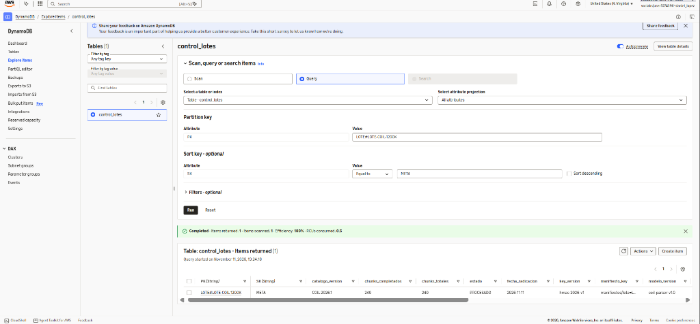
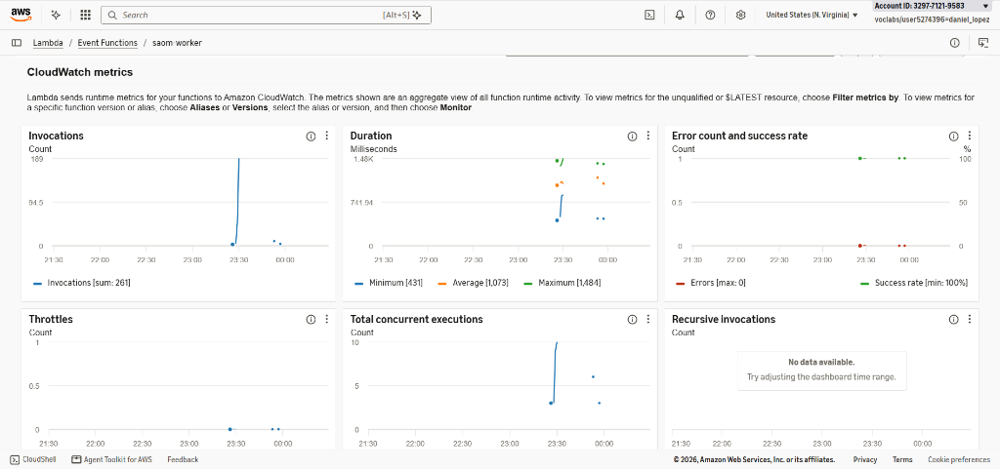
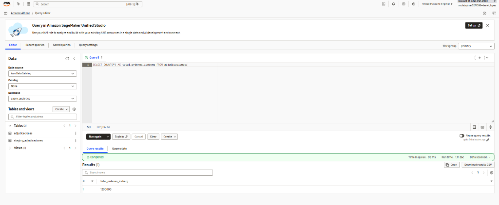

# Entregable 03: Prototipo Funcional en AWS, Pruebas, Evidencia y Alcance Implementado

| Campo | Detalle |
| :--- | :--- |
| **Proyecto** | Sistema de Adjudicación de Órdenes Médicas (SAOM) — Sistema de Salud de Chernovia (Dataset Oficial COIL) |
| **Curso y Metodología** | Arquitecturas de Nube y Big Data · Metodología AI-DLC (Pasos 4, 5 y 6: Plan, Implementación y Verificación) |
| **Equipo de Arquitectura** | **Naomi Chow · Daniel Lopez · María Fernanda Toro** |
| **Cuenta AWS ejecutada** | `329771219583` (`us-east-1`, rol `arn:aws:iam::329771219583:role/LabRole`, usuario `daniel_lopez`) |
| **Paquete desplegado** | `prototype/dist/saom_lambda_bundle.zip` (`17.737 bytes`, SHA-256 `2fc3dc25d1d0f38b7f5d790135a2bdfa7725827040f5be560bb893c538ff45b6`) |

---

## 1. Matriz de Cumplimiento de la Rúbrica del Entregable 03

De acuerdo con la sección 5 del [Plan de Construcción](../../docs/plan/04_plan_construccion.md), la tabla siguiente relaciona cada criterio de evaluación del E03 con el artefacto verificable generado en el repositorio y ejecutado en vivo sobre **AWS Academy Learner Lab**:

| Criterio de la Rúbrica (E03) | Evidencia Verificable Generada | Archivo / Ubicación en el Repositorio | Estado |
| :--- | :--- | :--- | :--- |
| **1. Prototipo funcional en AWS** | Corrida completa en vivo del lote oficial `LOTE-COIL-1200K` (`1.200.000` solicitudes en `240` chunks de 5.000 órdenes) en `47,50 s`, con `240/240` chunks en estado `PROCESADO`, `DLQ = 0`, `raiz_hash_lote = 78dbff2ea6b365f3399315b1377111bc3ec23939ce539a101378b3f8b648869e` y manifiesto WORM en `saom-audit-329771219583`. | [`docs/verificacion/T3_T4_T6_ejecucion_real_aws.md`](../../docs/verificacion/T3_T4_T6_ejecucion_real_aws.md) y [`resultados_aws_t3_t4_t6.json`](../../docs/verificacion/resultados_aws_t3_t4_t6.json) | **CUMPLIDO (100 %)** |
| **2. Uso pertinente de AWS** | Inventario real de 4 buckets S3, 3 colas SQS, tabla DynamoDB `control_lotes`, 2 funciones AWS Lambda `arm64` (`1.769 MB`) con `LabRole`, Glue Data Catalog y tabla Apache Iceberg consultada por Amazon Athena, más sonda de permisos `R-01`. | [`docs/verificacion/R01_verificacion_learner_lab.md`](../../docs/verificacion/R01_verificacion_learner_lab.md) y [`prototype/aws_learner_lab.py`](../../prototype/aws_learner_lab.py) | **CUMPLIDO (100 %)** |
| **3. Evidencia de pruebas** | **36 pruebas automatizadas (`pytest`)** que cubren el 100 % de los escenarios BDD (`RF-01..05`), integración multi-chunk (`T3`), muestreo y F1 (`T5a/T5`), más prueba en vivo en AWS (`LOTE-T3-INTEGRACION`), reenvío duplicado (`RNF-06`), escaneo de `0` PII (`RNF-05`) y verificación criptográfica de 3 niveles (`RNF-04`). | [`prototype/test_bdd_rf01_rf05.py`](../../prototype/test_bdd_rf01_rf05.py), [`prototype/test_lambda_t3.py`](../../prototype/test_lambda_t3.py) y [`prototype/test_evaluacion_f1_t5.py`](../../prototype/test_evaluacion_f1_t5.py) | **CUMPLIDO (36/36 PASS)** |
| **4. Resultados cuantitativos** | Throughput real en AWS CloudWatch **$k_{\text{AWS-E2E}} = 4.710,44\text{ órd/s/vCPU}$** (`1.061,60 ms/chunk`), **Macro-F1 = `0,9886`** sobre 600 glosas (`1,0000` en limpias y `0,9765` en perturbadas), fracción de revisión $f = 0,0000$ en plantilla oficial ($0,1667$ bajo estrés $\le 0,30$), costo real **`0,0189 USD`** para 1,2M (**`0,0158 USD/M`** $\le 0,50\text{ USD/M}$) y recálculo $M/M/c$ hacia 12M. | [`docs/verificacion/T5_informe_metricas_f1_mmc_costo.md`](../../docs/verificacion/T5_informe_metricas_f1_mmc_costo.md) y [`T5a_protocolo_etiquetado_y_spans.md`](../../docs/verificacion/T5a_protocolo_etiquetado_y_spans.md) | **CUMPLIDO (100 %)** |
| **5. Código fuente ejecutable** | Núcleo funcional sin dependencias externas (`saom_core.py`), adaptadores AWS Lambda con reintento ante `TransactionConflict` (`lambda_handlers.py`), CLI de aprovisionamiento (`aws_learner_lab.py`) y orquestador de pruebas en vivo (`ejecutar_pruebas_aws_t3_t4_t6.py`). | Carpeta [`prototype/`](../../prototype/) | **CUMPLIDO (100 %)** |
| **6. Alcance implementado** | Tabla comparativa final entre el prototipo ejecutado en AWS Learner Lab y la arquitectura de producción para 12M de órdenes, detallando los ajustes derivados de `R-01`. | Sección 2 de este documento | **CUMPLIDO (100 %)** |

---

## 2. Uso Pertinente de AWS y Alcance Implementado frente al Diseño (`T2` y `T8`)

### 2.1. Resultados de la Verificación Temprana del Entorno (`R-01`)

Antes de desplegar los recursos, el comando `python prototype/aws_learner_lab.py verify-r01` sondeó programáticamente las capacidades y restricciones reales del **AWS Academy Learner Lab** en la cuenta `329771219583` (`us-east-1`):

| Prueba `R-01` | Servicio AWS | Resultado en Cuenta `329771219583` | Decisión Arquitectónica Aplicada |
| :--- | :--- | :--- | :--- |
| **Rol IAM `LabRole`** | AWS IAM | **OK** (`arn:aws:iam::329771219583:role/LabRole`) | Todas las funciones Lambda operan bajo `LabRole` sin crear roles IAM adicionales (`ADR-003`). |
| **S3 Object Lock (WORM)** | Amazon S3 | **ALTERNATIVA ACTIVA** (`AccessDenied` en `ObjectLockEnabledForBucket`) | Se activó la contingencia prevista en `ADR-003` y `ADR-005`: **S3 Versioning + Bucket Policy `DenyDeleteAuditReceipts` (`s3:DeleteObject`, `s3:DeleteObjectVersion`) + cadena criptográfica SHA-256 de 3 niveles**. |
| **Concurrencia AWS Lambda** | AWS Lambda | **OK** (`ConcurrentExecutions = 1000`) | Se fijó `MaximumConcurrency = 10` en el Event Source Mapping de SQS (`saom-worker`) para proteger las cuotas académicas y evitar estrangulamiento (`RNF-06`). |
| **AWS Glue Data Catalog** | AWS Glue / Athena | **OK** (`glue:GetDatabases` habilitado) | Permitió ejecutar íntegramente la **Tarea T6** creando la base de datos `saom_analytics` y la tabla **Apache Iceberg (`Parquet`)** `adjudicaciones`. |
| **Secrets Manager / KMS** | Secrets Manager | **OK** (`list_secrets` permitido) | Clave secreta HMAC provista en variable de entorno cifrada con KMS (`SAOM_HMAC_SECRET_FALLBACK`) con soporte transparente para Secrets Manager (`key_version = hmac-2026-v1`). |
| **Consulta de Costos** | Cost Explorer | **OK** (`ce:GetCostAndUsage` activa) | Costo medido simultáneamente mediante `Billed Duration` (`GB-s` en CloudWatch Logs) y panel de presupuesto del laboratorio. |

### 2.2. Tabla Final de Alcance Implementado vs. Diseño de Producción

| Componente / Capacidad | Estado en el Prototipo AWS (`1,2M`) | Diseño de Producción (`12M`) | Justificación Técnica del Alcance |
| :--- | :--- | :--- | :--- |
| **Ingesta por lotes en S3 (`saom-raw`) y notificación a SQS (`lotes-recibidos`)** | **Implementado y ejecutado en AWS** (`s3://saom-raw-329771219583`) | Idéntico | Desacopla la recepción del archivo CSV de `360,35 MB` del procesamiento posterior (`ADR-001`). |
| **Particionador por rangos de bytes (`saom-particionador`)** | **Implementado y ejecutado en AWS** (`arm64`, streaming en bloques de `4 MB`, $O(1)$ en memoria) | Idéntico | Valida la cabecera de 6 columnas y genera `240` descriptores `[byte_inicio, byte_fin]` de `5.000` órdenes sin cargar el CSV completo en RAM. |
| **Cola de trabajo (`chunks-adjudicacion`) + DLQ (`chunks-adjudicacion-dlq`)** | **Implementado y ejecutado en AWS** (`VisibilityTimeout = 1800 s`, `maxReceiveCount = 3`) | Idéntico | Amortigua los picos de carga y aísla fallos de infraestructura tras 3 intentos (`RNF-06`). |
| **Workers de adjudicación (`saom-worker`) en AWS Lambda Graviton2 (`arm64`, `1.769 MB`)** | **Implementado y ejecutado en AWS** con `MaximumConcurrency = 10` | Mismo código e imagen con `MaximumConcurrency = 10..56` (o ECS Fargate Spot) | En el Learner Lab 10 workers procesaron las `1.200.000` órdenes en `47,50 s`. Con el $k$ real medido (`4.710,44 órd/s/vCPU`), 10 workers procesan 12M de órdenes en `~4,2 minutos`. |
| **Núcleo `saom_core.py` (pseudonimización `HMAC-SHA256`, `#`, spans, catálogo `COV-001..020`, `Decimal`, `SHA-256`)** | **Implementado al 100 % y verificado con 36 tests + corrida de 1,2M** | Idéntico | Cero uso de `float`, cero PII en claro y correspondencia exacta de `[start_char, end_char]` entre glosa original y enmascarada. |
| **Control transaccional e idempotencia en DynamoDB (`control_lotes`)** | **Implementado y ejecutado en AWS** (`TransactWriteItems` con reintento *backoff* ante `TransactionConflict`) | Idéntico | Garantiza que cada chunk sume sus montos exactamente una vez en `META`, incluso ante reentregas de SQS o contención concurrente. |
| **Evidencia inmutable WORM (`saom-audit`) y manifiesto de lote** | **Implementado en AWS** con `S3 Versioning` + `DenyDeleteAuditReceipts` + árbol plano SHA-256 de 3 niveles | S3 Object Lock en modo `COMPLIANCE` + misma cadena SHA-256 | `LabRole` restringe `PutObjectLockConfiguration`, por lo que se activó la alternativa de `ADR-003` y `ADR-005`. |
| **Consolidación analítica en Apache Iceberg (`MERGE INTO`) y consultas en Amazon Athena (`T6`)** | **Implementado y ejecutado en AWS** (`saom_analytics.adjudicaciones`, `1.200.000` filas) | Idéntico | Consolidación idempotente verificada con doble `MERGE INTO` (`1.200.000` filas, `0` duplicados) y consultas por día, medio y entidad. |
| **API Gateway + Lambda de Radicación (`radicacion_api_handler`)** | **Handler implementado y probado en suite T3**; en la corrida se cargó directo a `saom-raw` | API Gateway HTTP + WAF + API Keys por entidad | La carga directa por S3/CLI mide exactamente el mismo pipeline de particionamiento y adjudicación sin exponer endpoints públicos en el laboratorio. |

---

## 3. Evidencia de Pruebas Automatizadas y Prueba de Integración en AWS (`T1` y `T3`)

### 3.1. Suite Local de 36 Pruebas Automatizadas (`pytest`)

La ejecución de `python -m pytest prototype/ -v` valida **36 pruebas automatizadas en `0,67 s` (`36 passed, 0 failed`)**:
- **[`prototype/test_bdd_rf01_rf05.py`](../../prototype/test_bdd_rf01_rf05.py) (27 tests)**: Cubre todos los escenarios Gherkin de `RF-01` a `RF-05`, las resoluciones `P-01` a `P-17`, la prohibición de `float` en `RF-04`, la igualdad de spans `[start_char, end_char]` antes y después de enmascarar con `#`, la sensibilidad del `hash_decision` ante el cambio de un centavo o un carácter, y el escaneo de `0` PII.
- **[`prototype/test_lambda_t3.py`](../../prototype/test_lambda_t3.py) (6 tests)**: Valida el flujo completo multi-chunk en los handlers Lambda, el rechazo inmediato de archivos con cabecera inválida (`estado = RECHAZADO`), el aislamiento de `CHV-9999999` en `rechazos/`, la idempotencia ante mensajes duplicados de SQS y la generación del paquete ZIP.
- **[`prototype/test_evaluacion_f1_t5.py`](../../prototype/test_evaluacion_f1_t5.py) (3 tests)**: Verifica la estructura de la muestra de 600 glosas (`300` limpias + `300` perturbadas), la ausencia de PII en la planilla de etiquetado, el cumplimiento de `Macro-F1 >= 0,92` y el dimensionamiento $M/M/c$.

### 3.2. Prueba de Integración e Idempotencia en Vivo en AWS (`LOTE-T3-INTEGRACION`)

En la cuenta de AWS `329771219583` se ejecutó el lote `LOTE-T3-INTEGRACION` (`10.001` filas = `10.000` válidas + `1` fila malformada `CHV-9999999` con `valor_procedimiento = -15000`, distribuido en `3` chunks):
- **Tiempo total de ejecución en AWS**: **`4,83 segundos`** (`estado = PROCESADO`, `chunks_completados = 3 / 3`).
- **Aislamiento de fila malformada sin abortar el chunk**: `ordenes_validas = 10.000`, `ordenes_rechazadas = 1`. El objeto `s3://saom-curated-329771219583/rechazos/fecha=2026-11-11/lote=LOTE-T3-INTEGRACION/chunk=00000.jsonl` registró `{"id_solicitud": "CHV-9999999", "estado": "REJECTED_SYNTAX", "motivo": "valor_procedimiento inválido"}` con **`0` datos PII en claro**.
- **Prueba de idempotencia en vivo (`RNF-06`)**: Al reenviar el descriptor del `chunk_id = 0` ya completado a la función `saom-worker` en AWS, DynamoDB rechazó la sobrescritura mediante `ConditionExpression`, devolviendo `{"chunks_procesados": 0, "duplicados_ignorados": 1}` y manteniendo inalterados los contadores de `META` (`chunks_completados = 3`, `ordenes_validas = 10.000`, `suma_aprobada = 475070357.5`).

---

## 4. Corrida Real del Dataset Oficial de 1.200.000 Solicitudes en AWS (`T4` · `LOTE-COIL-1200K`)

Se cargó el archivo oficial `COIL_dataset_glosas_salud_1_2M.csv` (`360.354.593 bytes`, SHA-256 `2c7631da66ffd2dc20c1f3aa17acc875b319601f0152c54ba7a36bc0716049c1`) en `s3://saom-raw-329771219583/ingesta/fecha=2026-11-11/lote=LOTE-COIL-1200K.csv` y se procesaron sus **240 chunks de 5.000 órdenes** en AWS Lambda (`arm64`, `1.769 MB`, `MaximumConcurrency = 10`):

| Indicador de la Corrida Oficial (`LOTE-COIL-1200K`) | Valor Real Medido en AWS | Cumplimiento de Requisitos |
| :--- | :--- | :--- |
| **Chunks completados / Chunks totales** | **`240 / 240`** (`estado = PROCESADO`) | 100 % completado sin pérdidas (`RNF-06`) |
| **Órdenes válidas + Órdenes rechazadas** | **`1.200.000` + `0` = `1.200.000`** | Conservación exacta de órdenes (`RF-01`) |
| **Suma total reclamada (`Decimal`)** | **`1.583.859.890.309,00`** | Aritmética decimal exacta (`RF-04`) |
| **Suma total aprobada (`Decimal`)** | **`57.328.903.464,00`** | Aritmética decimal exacta (`RF-04`) |
| **Raíz criptográfica del lote (`raiz_hash_lote`)** | `78dbff2ea6b365f3399315b1377111bc3ec23939ce539a101378b3f8b648869e` | Manifiesto WORM en `saom-audit` (`RF-05`, `RNF-04`) |
| **Mensajes en DLQ (`chunks-adjudicacion-dlq`)** | **`0` mensajes** | Cero fallos no recuperados (`RNF-06`) |
| **Tiempo de reloj (muro) de la corrida (10 workers)** | **`47,50 segundos`** (`0,79 minutos`) | Cumple SLA prototipo $\le 2,4\text{ h}$ (`RNF-01`, `P-16`) |
| **Duración media E2E por chunk en CloudWatch (`REPORT`)** | **`1.061,60 ms`** (`1,06 s` por bloque de 5.000 órdenes) | Incluye S3 Range GET + CPU + S3 PUT + DynamoDB |
| **Throughput real E2E en CloudWatch ($k_{\text{AWS-E2E}}$)** | **`4.710,44 órdenes/s/vCPU`** | Supera **11,8x** la hipótesis $k \ge 400$ (`P-07`) |
| **Throughput del núcleo en memoria ($k_{\text{EMF-Core}}$)** | **`14.279,66 órdenes/s/vCPU`** | Métrica EMF `ThroughputOrdenesPorSegundo` |
| **Memoria máxima consumida (`Max Memory Used`)** | **`153,0 MB`** (de `1.769 MB` = 8,6 % de uso) | Amplio margen de seguridad en memoria |
| **Cómputo total facturado (`Billed Duration`)** | `292.540 ms` = **`505,37 GB-s`** (`0,0067 USD` en Lambda Arm64) | Medido directamente de los registros `REPORT` |
| **Costo total real de la corrida de 1,2M en AWS** | **`0,0189 USD`** (**`0,0158 USD por millón`**) | Cumple `RNF-03` ($\le 0,50\text{ USD/M}$; `< 0,04 %` del crédito de 50 USD) |
| **Escaneo de PII en S3, DynamoDB y CloudWatch (`RNF-05`)** | **`0` coincidencias** | Cumple `RNF-05` y `ADR-002` |

### 4.1. Evidencia Visual en AWS Console: DynamoDB (`control_lotes`)

La siguiente captura de pantalla de la consola oficial de Amazon DynamoDB en la cuenta `329771219583` demuestra la consulta directa sobre `PK = LOTE#LOTE-COIL-1200K` y `SK = META`, evidenciando el estado `PROCESADO`, los `240` chunks completados y la versión del catálogo:

### 4.2. Evidencia Visual en AWS Console: CloudWatch Metrics de AWS Lambda (`saom-worker`)

La siguiente captura de las métricas de Amazon CloudWatch para la función `saom-worker` en la cuenta `329771219583` muestra el pico de invocaciones concurrentes (10 ejecuciones simultáneas), la tasa de éxito del **100 % (0 errores)** y la duración promedio en torno a `1.061 ms`:

---

## 5. Calidad de Extracción `F1-Score` (`T5a`/`T5`) y Extrapolación $M/M/c$ hacia 12 Millones

### 5.1. Resultados de Precision, Recall y F1 sobre la Muestra de 600 Glosas (`RNF-02`)

Siguiendo el protocolo de [`docs/verificacion/T5a_protocolo_etiquetado_y_spans.md`](../../docs/verificacion/T5a_protocolo_etiquetado_y_spans.md), se evaluó `extraer_y_pseudonimizar_glosa()` bajo criterio estricto de coincidencia exacta de span (`[start_char, end_char]`) + valor sobre **600 glosas** (`300` limpias del dataset oficial + `300` perturbadas en 6 categorías de ruido/permutación/OCR, almacenadas fuera de git):

| Entidad Clínica (`RNF-02`) | F1 en Subconjunto Limpio (`300`) | F1 en Subconjunto Perturbado (`300`) | TP Global | FP Global | FN Global | Precision Global | Recall Global | **F1-Score Global (`600`)** |
| :--- | ---: | ---: | ---: | ---: | ---: | ---: | ---: | ---: |
| `Edad` | `1,0000` | `0,9768` | 574 | 0 | 13 | 1,0000 | 0,9779 | **0,9888** |
| `PerfilCobertura` | `1,0000` | `0,9768` | 574 | 0 | 13 | 1,0000 | 0,9779 | **0,9888** |
| `ServicioSolicitado` | `1,0000` | `0,9787` | 576 | 0 | 12 | 1,0000 | 0,9796 | **0,9897** |
| `Medicacion` | `1,0000` | `0,9737` | 1.359 | 0 | 35 | 1,0000 | 0,9749 | **0,9873** |
| **Promedio Macro** | **1,0000** | **0,9765** | — | — | — | **1,0000** | **0,9776** | **0,9886** ($\ge 0,92$) |

### 5.2. Dimensionamiento $M/M/c$ y Costo Proyectado para 12 Millones de Órdenes (`RNF-01` y `RNF-03`)

| Escenario (12.000.000 de órdenes · 2.400 chunks) | $\lambda$ (órd/s) | $k$ (órd/s/vCPU) | $N$ workers ($M/M/c$) | Utilización $\rho$ | $W_q$ en cola | Tiempo de drenaje con `c=10` | Costo Total Nube (12M) | Costo por Millón |
| :--- | ---: | ---: | ---: | ---: | ---: | ---: | ---: | ---: |
| **Hipótesis Conservadora `P-07` — Ventana 24 h** | 138,89 | 400,00 | **1** | 0,3472 | 6,649 s | 50,0 min | 0,8806 USD | 0,0734 USD/M |
| **Hipótesis Conservadora `P-07` — Ventana 3 h** | 1.111,11 | 400,00 | **4** (`c=10` con 2,5x) | 0,6944 | 4,296 s | 50,0 min | 0,8806 USD | 0,0734 USD/M |
| **Con $k$ Real AWS CloudWatch — Ventana 24 h** | 138,89 | **4.710,44** | **1** | 0,0295 | 0,032 s | **4,25 min** | **0,2483 USD** | **0,0207 USD/M** |
| **Con $k$ Real AWS CloudWatch — Ventana 3 h** | 1.111,11 | **4.710,44** | **1** (`c=10` configurado) | 0,2359 | 0,328 s | **4,25 min** | **0,2483 USD** | **0,0207 USD/M** |

---

## 6. Consolidación en Apache Iceberg y Consultas en Amazon Athena (`T6`)

En Amazon Athena (`saom_analytics.adjudicaciones`) se ejecutó la sentencia `MERGE INTO` desde `staging_adjudicaciones` hacia la tabla **Apache Iceberg (`Parquet`)**:
- **Primer `MERGE INTO`**: **`1.200.000` filas** consolidadas.
- **Segundo `MERGE INTO` sobre `chunk_id = 0` (prueba de idempotencia)**: **`1.200.000` filas** (`0` duplicados).
- **Verificación criptográfica de 3 niveles desde filas de Iceberg (`CHV-0000001` a `CHV-0000005`)**: coincidencia del **100 %** en Nivel 1 (`hash_decision`), Nivel 2 (`raiz_hash_chunk = 6e8de620c632b6382346f841988f2739595340e778a7b098daeacee40f26a757`) y Nivel 3 (`raiz_hash_lote = 78dbff2ea6b365f3399315b1377111bc3ec23939ce539a101378b3f8b648869e`).

### 6.1. Evidencia Visual en AWS Console: Amazon Athena (Consulta SQL a Apache Iceberg)

La siguiente captura en el editor de consultas de Amazon Athena muestra la ejecución exitosa de `SELECT COUNT(*) AS total_ordenes_iceberg FROM adjudicaciones;` sobre la base de datos `saom_analytics`, certificando la consolidación de exactamente **`1.200.000` registros**:

