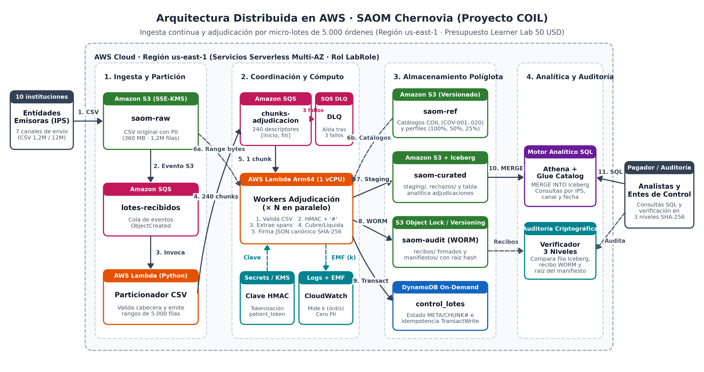
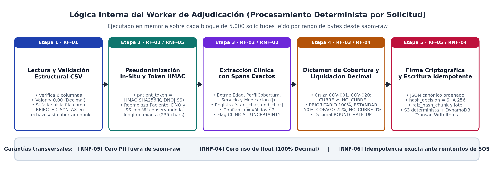

# Entregable 04: Documento Consolidado Final de Arquitectura, Prototipo AWS y Verificación

| Campo | Detalle |
| :--- | :--- |
| **Proyecto** | Sistema de Adjudicación de Órdenes Médicas (SAOM) — Sistema de Salud de Chernovia (Licitación COIL) |
| **Metodología** | AI-DLC (6 Pasos: Problema/Estado del Arte, Requisitos BDD/RNF, Arquitectura C4/ADR, Plan, Implementación y Verificación) |
| **Equipo de Arquitectura** | **Naomi Chow · Daniel Lopez · María Fernanda Toro** |
| **Estado del Ciclo AI-DLC** | **Pasos 1 a 6 Completados y Verificados en AWS Academy Learner Lab (`329771219583`, `us-east-1`)** |

---

## 1. Resumen Ejecutivo y Contexto del Problema (Paso 1 AI-DLC · E01 v2)

El Ministerio de Salud de la República Federal de **Chernovia** requiere adjudicar lotes masivos de hasta **12.000.000 de órdenes médicas en menos de 24 horas** (con una meta interna de ingeniería del equipo de **3 horas** en ventana nocturna a `1.111,11 órdenes/s`), determinando para cada orden si el servicio solicitado está cubierto (`CUBRE` / `NO_CUBRE`), liquidando el monto aprobado al **100 %, 50 %, 25 % o 0 %** según el perfil de cobertura del afiliado (`PRIORITARIO`, `ESTANDAR`, `COPAGO`) y emitiendo evidencia criptográfica inmutable sin exponer información personal identificable (PII).

La revisión sistemática de la literatura (52 fuentes indexadas `[1]` a `[52]` en el [Entregable 01 v2](../E01/Entregable_01_Propuesta_Arquitectura_Salud_COIL_v2.docx)) demostró que:
1. **Inviabilidad de la orquestación serverless orden por orden con APIs cognitivas por carácter**: Procesar 12 millones de glosas (~213 caracteres promedio, facturadas al mínimo de 300 caracteres = 3 unidades de 100 caracteres por solicitud = 36 millones de unidades) en **Amazon Comprehend Medical** más **AWS Step Functions Standard** (`10` transiciones/orden) cuesta **`244.500 USD/día`** aplicando la tarifa escalonada oficial de AWS (`10M u. × 0,0105 USD + 26M u. × 0,00525 USD = 241.500 USD` + `3.000 USD` de Step Functions) o **`381.000 USD/día`** a tarifa plana Tier 1, además de que Comprehend Medical opera únicamente en idioma inglés.
2. **Inviabilidad de clústeres pesados en el entorno de validación académica**: Un clúster Apache Spark sobre Amazon EMR (`24 × c6g.4xlarge`, ~220 USD/día) excede los límites de instancias, vCPU, permisos IAM y presupuesto (`50 USD`) del **AWS Academy Learner Lab**.
3. **Solución adoptada (`ADR-001` a `ADR-005`)**: Una **arquitectura híbrida serverless por micro-lotes (chunks de 5.000 órdenes)** sobre **AWS Lambda Graviton2 (`arm64`, `1.769 MB`)**, que elimina el cobro por carácter y por transición individual, logrando un costo real medido en AWS de **`0,0189 USD`** para el dataset oficial de `1.200.000` solicitudes (**`0,0158 USD por millón`**, o **`0,2483 USD`** proyectados para 12 millones de órdenes), lo que representa un **ahorro superior al 99,9 %** frente a la línea base de auditoría manual (`0,80 USD/orden`).

---

## 2. Requisitos Funcionales (BDD) y No Funcionales Verificados (Paso 2 AI-DLC)

### 2.1. Requisitos del Enunciado vs. Metas de Ingeniería del Equipo

| Dimensión | Requisito del Enunciado | Meta Propia del Equipo (`RNF`) | Resultado Real Medido en AWS (`T4`/`T5`/`T6`) |
| :--- | :--- | :--- | :--- |
| **Volumen y ventana (SLA)** | 12M de órdenes en `< 24 h` (`138,89 órd/s`) | 12M en `<= 3 h` (`1.111,11 órd/s`); 1,2M en `<= 2,4 h` | **1,2M procesadas en `47,50 s`** (`4,25 min` proyectados para 12M con 10 workers) |
| **Calidad de extracción** | Extraer paciente, edad, servicio y medicación | `Macro-F1 >= 0,92` en 4 entidades con spans exactos (`RNF-02`) | **`Macro-F1 = 0,9886`** (`1,0000` en 300 limpias y `0,9765` en 300 perturbadas) |
| **Costo de operación** | Costo razonable | `<= 0,50 USD/millón` en laboratorio y ahorro `>= 70 %` (`RNF-03`) | **`0,0158 USD/millón`** (`0,0189 USD` para 1,2M; ahorro del **99,99 %**) |
| **Trazabilidad y privacidad** | Registro trazable de cada decisión | Cadena SHA-256 de 3 niveles (`RNF-04`) y `0` PII en claro (`RNF-05`) | **`100 %` verificado en 3 niveles** desde Iceberg hasta `raiz_hash_lote`; **`0` PII** |
| **Tolerancia a fallos** | Escalabilidad y resiliencia | Idempotencia exacta en DynamoDB e Iceberg y aislamiento de filas malformadas (`RNF-06`) | **`1.200.000` órdenes exactas** tras doble `MERGE INTO` y `duplicados_ignorados = 1` en reenvío |

---

## 3. Diseño Técnico Simplificado y Decisiones Arquitectónicas (Paso 3 AI-DLC · E02)

### 3.1. Vista General del Flujo en AWS (8 Pasos numerados)

### 3.2. Pipeline Interno Determinista de un Worker (`saom_core.py`)

### 3.3. Síntesis de los 5 Architecture Decision Records (`ADR-001` a `ADR-005`)

| ADR | Decisión | Justificación y Verificación Empírica |
| :--- | :--- | :--- |
| **[ADR-001](../../docs/design/adr/ADR-001-patron-arquitectonico.md)** | Ingesta desacoplada en S3 + SQS y procesamiento paralelo por chunks de 5.000 órdenes (`Range=bytes=inicio-fin`). | Reduce en **5.000x** las llamadas de coordinación frente al patrón orden por orden; verificado con 240 chunks en AWS. |
| **[ADR-002](../../docs/design/adr/ADR-002-estrategia-trazabilidad-y-pii.md)** | Pseudonimización `HMAC-SHA256`, enmascaramiento con `#` preservando longitud y cadena SHA-256 de 3 niveles. | Conserva intactos los desplazamientos `[start_char, end_char]` y logra `0` coincidencias de PII en S3, DynamoDB y CloudWatch. |
| **[ADR-003](../../docs/design/adr/ADR-003-dimensionamiento-prototipo-vs-produccion.md)** | Prototipo con las 1.200.000 órdenes oficiales en el Learner Lab (`LabRole`) y extrapolación $M/M/c$ hacia 12M. | Ejecutado consumiendo solo `0,0189 USD` del crédito académico de `50 USD`. |
| **[ADR-004](../../docs/design/adr/ADR-004-motor-computo-workers.md)** | Workers sin estado en AWS Lambda Graviton2 (`arm64`, `1.769 MB` = 1 vCPU) portables a ECS Fargate Spot. | Duración media real en CloudWatch de `1.061,60 ms` por chunk (`4.710,44 órdenes/s/vCPU`) y `153 MB` de RAM pico. |
| **[ADR-005](../../docs/design/adr/ADR-005-almacenamiento-analitico-y-control.md)** | Persistencia políglota: DynamoDB (`control_lotes`), Apache Iceberg en S3 (`adjudicaciones`) y bucket WORM (`saom-audit`). | Verificado con `TransactWriteItems` (con *backoff* ante `TransactionConflict`), doble `MERGE INTO` en Athena (`1.200.000` filas) y manifiesto WORM. |

---

## 4. Resultados de la Ejecución Real en AWS (`T2`, `T3`, `T4`, `T5` y `T6` · E03)

### 4.1. Corrida Completa del Dataset Oficial (`LOTE-COIL-1200K` · 1.200.000 Solicitudes)

- **Identificador del lote**: `LOTE-COIL-1200K` (`s3://saom-raw-329771219583/ingesta/fecha=2026-11-11/lote=LOTE-COIL-1200K.csv`, `360.354.593 bytes`).
- **Progreso y tiempo total**: **`240 / 240` chunks completados en `47,50 segundos`** con 10 workers concurrentes (`ordenes_validas = 1.200.000`, `ordenes_rechazadas = 0`, `DLQ = 0`).
- **Liquidación financiera exacta (`Decimal`)**:
  - Valor total reclamado: **`1.583.859.890.309,00`**
  - Valor total aprobado por el fondo público: **`57.328.903.464,00`**
- **Raíz criptográfica del lote (`raiz_hash_lote`)**: `78dbff2ea6b365f3399315b1377111bc3ec23939ce539a101378b3f8b648869e`.

### 4.2. Consolidación en Apache Iceberg y Consultas Analíticas en Amazon Athena (`T6`)

La tabla Iceberg `saom_analytics.adjudicaciones` consolidó las **`1.200.000` órdenes** y demostró idempotencia exacta tras repetir `MERGE INTO` (`1.200.000` filas). El desglose por fecha y por canal emisor obtenido en Athena es el siguiente:

| Día de Solicitud | Órdenes Adjudicadas | Total Reclamado | Total Aprobado |
| :--- | ---: | ---: | ---: |
| `2026-05-04` | 402.000 | 529.215.196.182,00 | 19.155.939.616,75 |
| `2026-05-05` | 396.000 | 522.711.751.027,00 | 18.950.939.658,50 |
| `2026-05-06` | 402.000 | 531.932.943.100,00 | 19.222.024.188,75 |
| **Total Oficial** | **1.200.000** | **1.583.859.890.309,00** | **57.328.903.464,00** |

---

## 5. Conclusiones e Índice Maestro de Entregables

1. **Trazabilidad extremo a extremo bajo AI-DLC**: Cada requisito (`RF-01..05`, `RNF-01..06`) está vinculado a una decisión arquitectónica (`ADR-001..005`), a una función de código en `prototype/`, a un test automatizado en `pytest` (`36 passed`) y a una métrica real medida en AWS (`T3_T4_T6_ejecucion_real_aws.md`).
2. **Índice de documentos finales del repositorio**:
   - **Entregable 01 (v2 corregida)**: [`entregables/E01/Entregable_01_Propuesta_Arquitectura_Salud_COIL_v2.docx`](../E01/Entregable_01_Propuesta_Arquitectura_Salud_COIL_v2.docx)
   - **Entregable 02 (Diseño Técnico Simplificado)**: [`entregables/E02/Entregable_02_Diseno_Tecnico_Salud_COIL.docx`](../E02/Entregable_02_Diseno_Tecnico_Salud_COIL.docx)
   - **Entregable 03 (Prototipo en AWS y Evidencias)**: [`entregables/E03/Entregable_03_Prototipo_Evidencia_Salud_COIL.docx`](../E03/Entregable_03_Prototipo_Evidencia_Salud_COIL.docx)
   - **Entregable 04 (Documento Consolidado + Guion de Pitch)**: [`entregables/E04/Entregable_04_Documento_Consolidado_Salud_COIL.docx`](Entregable_04_Documento_Consolidado_Salud_COIL.docx) y [`entregables/E04/Entregable_04_Guion_Pitch_Sustentacion_COIL.docx`](Entregable_04_Guion_Pitch_Sustentacion_COIL.docx)
   - **Bitácora COIL**: [`docs/bitacora/bitacora_decisiones.md`](../../docs/bitacora/bitacora_decisiones.md)
