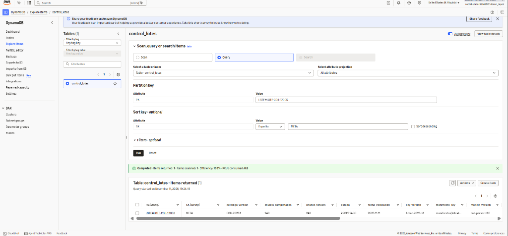
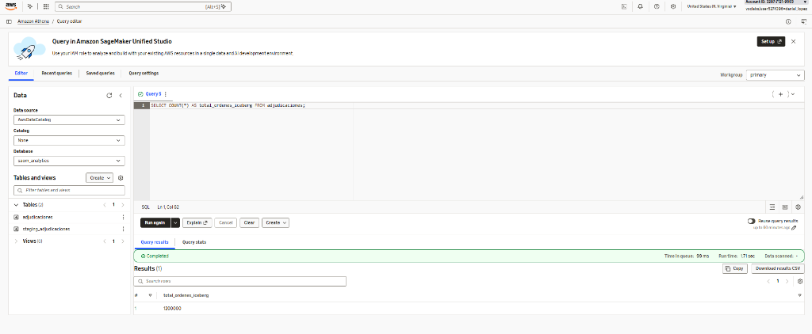
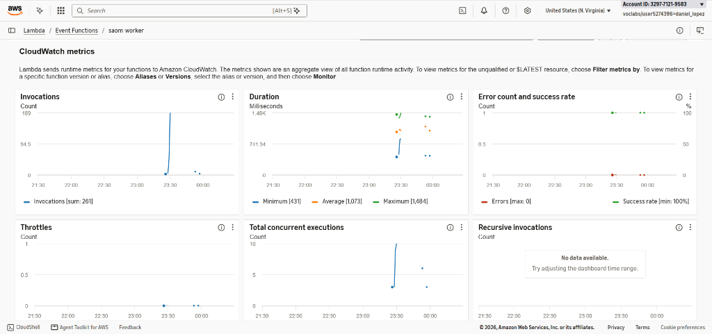

# Entregable 04: Guía Operativa de Demostración en Vivo ante el Comité Evaluador

| Campo | Detalle |
| :--- | :--- |
| **Objetivo** | Comprobar en tiempo real (o mediante evidencia certificada si la sesión del Learner Lab está cerrada) los resultados en **Amazon DynamoDB**, **Amazon Athena (Apache Iceberg)** y **Amazon CloudWatch / AWS Lambda** |
| **Cuenta AWS** | `329771219583` (`us-east-1`, rol `LabRole`, usuario `daniel_lopez`) |
| **Tiempo estimado de demo** | **2 a 3 minutos** durante la sesión de preguntas del comité |

---

## 1. Preparación Previa (10 Minutos antes de la Sustentación)

1. Iniciar sesión en **AWS Academy Learner Lab** y pulsar **Start Lab** (esperar a que el círculo de `AWS` pase a verde).
2. Dejar abiertas **3 pestañas en el navegador** en la región **`us-east-1` (N. Virginia)**:
   - **Pestaña 1 — Amazon DynamoDB**: `DynamoDB` → `Explore items` → tabla **`control_lotes`**.
   - **Pestaña 2 — Amazon Athena**: `Athena` → `Query editor` → `Database: saom_analytics`.
   - **Pestaña 3 — AWS Lambda / CloudWatch**: `Lambda` → `Functions` → **`saom-worker`** → pestaña **`Monitor`**.
3. Si se desea ejecutar un comando desde la terminal local, actualizar las credenciales temporales en `C:\Users\danie\.aws\credentials` copiando el bloque de `AWS Details` → `AWS CLI: Show`.

---

## 2. Paso 1 de la Demo (45 s) — Comprobación del Lote `LOTE-COIL-1200K` en Amazon DynamoDB

En la **Pestaña 1 (`DynamoDB` → `control_lotes` → `Explore items`)**:
1. Seleccionar **Query**.
2. En **Partition key (`PK`)**, ingresar:
   ```text
   LOTE#LOTE-COIL-1200K
   ```
3. En **Sort key (`SK`)**, seleccionar `Equal to` e ingresar:
   ```text
   META
   ```
4. Pulsar **Run** y mostrar al comité la fila devuelta:
   - `estado = PROCESADO`
   - `chunks_completados = 240` y `chunks_totales = 240`
   - `ordenes_validas = 1200000` y `ordenes_rechazadas = 0`
   - `suma_reclamada = 1583859890309.00` y `suma_aprobada = 57328903464.00`
   - `raiz_hash_lote = 78dbff2ea6b365f3399315b1377111bc3ec23939ce539a101378b3f8b648869e`



---

## 3. Paso 2 de la Demo (60 s) — Consultas Analíticas en Vivo en Amazon Athena (`Apache Iceberg`)

En la **Pestaña 2 (`Amazon Athena` → `Database: saom_analytics`)**, pegar y ejecutar cualquiera de las tres consultas siguientes según lo solicite el jurado:

### Consulta A — Verificar las `1.200.000` órdenes consolidadas sin duplicados (`RNF-06`)
```sql
SELECT
    COUNT(*) AS total_filas_iceberg,
    COUNT(DISTINCT id_solicitud) AS solicitudes_unicas,
    SUM(valor_procedimiento) AS total_reclamado,
    SUM(valor_aprobado) AS total_aprobado
FROM saom_analytics.adjudicaciones;
```
- **Resultado esperado (`~1,7 s`)**: `total_filas_iceberg = 1200000`, `solicitudes_unicas = 1200000`, `total_reclamado = 1583859890309.00`, `total_aprobado = 57328903464.00`.

### Consulta B — Liquidación agregada por Día de Solicitud y Medio Emisor (`ADR-005`)
```sql
SELECT
    SUBSTR(fecha_solicitud, 1, 10) AS dia_solicitud,
    COUNT(*) AS ordenes,
    SUM(valor_procedimiento) AS suma_reclamada,
    SUM(valor_aprobado) AS suma_aprobada
FROM saom_analytics.adjudicaciones
GROUP BY SUBSTR(fecha_solicitud, 1, 10)
ORDER BY dia_solicitud;
```
- **Resultado esperado**: `2026-05-04` (`402.000` órd., `19.155.939.616,75` aprobados), `2026-05-05` (`396.000` órd., `18.950.939.658,50` aprobados), `2026-05-06` (`402.000` órd., `19.222.024.188,75` aprobados).

### Consulta C — Inspeccionar una orden individual con `patient_token` (0 PII) y `hash_decision` (`RNF-04`, `RNF-05`)
```sql
SELECT
    id_solicitud,
    patient_token,
    perfil_cobertura,
    servicio_codigo,
    dictamen,
    porcentaje_aplicado,
    valor_procedimiento,
    valor_aprobado,
    hash_decision
FROM saom_analytics.adjudicaciones
WHERE id_solicitud IN ('CHV-0000001', 'CHV-0000002', 'CHV-0000003', 'CHV-0000004', 'CHV-0000005')
ORDER BY id_solicitud;
```



---

## 4. Paso 3 de la Demo (45 s) — Telemetría y Rendimiento en CloudWatch / AWS Lambda

En la **Pestaña 3 (`AWS Lambda` → `saom-worker` → `Monitor`)**:
1. Mostrar las gráficas de **Invocations** (`261` invocaciones totales entre `T3`, `T4` y pruebas de reenvío), **Duration** (`Average ~1.061 ms`, `Minimum 431 ms`, `Maximum 1.484 ms`), **Error count and success rate** (`0 errors`, `100 % success rate`) y **Total concurrent executions** (pico exacto en `10` workers según `MaximumConcurrency = 10`).
2. Si el jurado desea ver los logs detallados o las métricas EMF (`ThroughputOrdenesPorSegundo`), abrir **View CloudWatch logs** → `/aws/lambda/saom-worker` y mostrar las líneas `REPORT` con `Memory Size: 1769 MB` y `Max Memory Used: 153 MB`.


