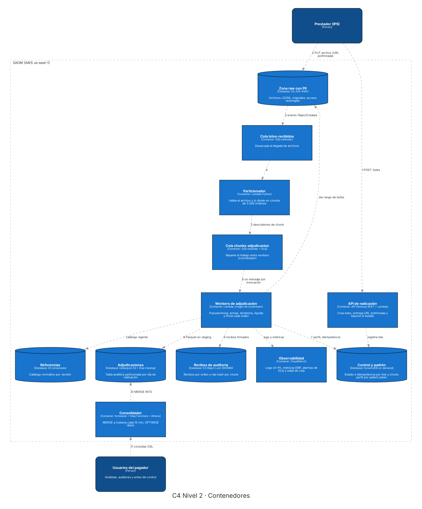
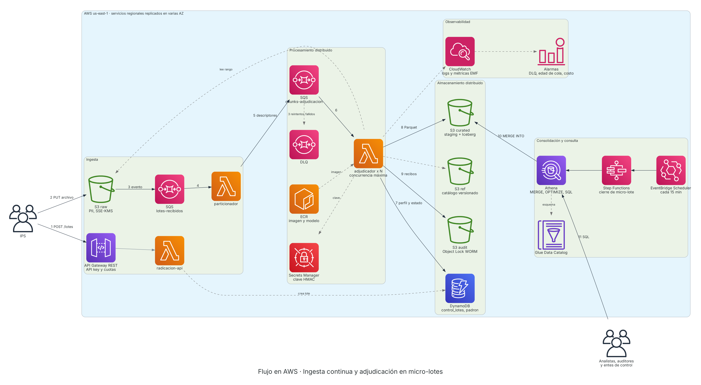
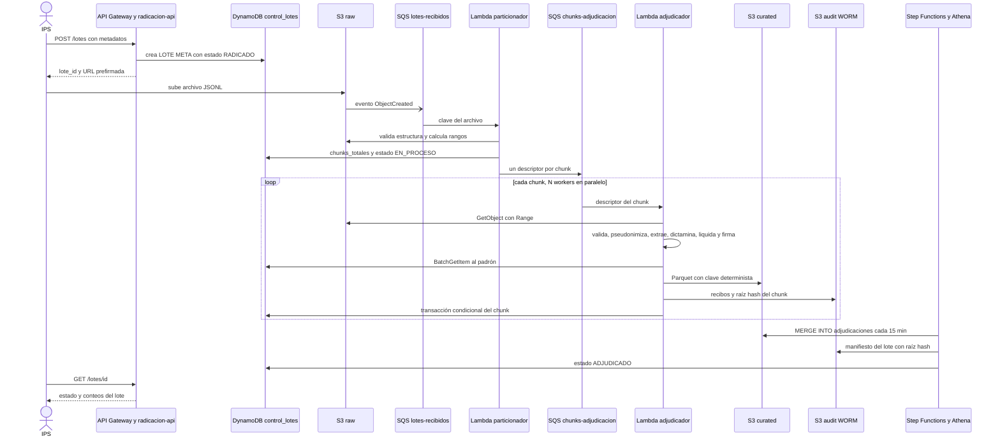

# Diseño de Arquitectura Técnica y Diagrama de Componentes en AWS

| Campo | Valor |
| :--- | :--- |
| Proyecto | Arquitectura distribuida en AWS para auditoría y adjudicación masiva de órdenes médicas (Proyecto COIL) |
| Entregable | 2, Diseño técnico (diagrama y justificación) |
| Fase AI-DLC | Construction, diseño de infraestructura |
| Versión | 0.1.0 (borrador para revisión del equipo) |
| Depende de | ADR-001, ADR-002, ADR-003, RF-01 a RF-05, RNF-01 a RNF-06 |
| Decisiones nuevas | [ADR-004](adrs/ADR-004-computo-workers-lambda.md) y [ADR-005](adrs/ADR-005-almacenamiento-poliglota.md) |

---

## 1. Resumen de la decisión

La solución es una arquitectura **cloud native y orientada a eventos** que materializa la ruta híbrida de ADR-001. Las IPS radican lotes de manera continua y los suben directamente a Amazon S3 mediante una URL prefirmada. Cada archivo se divide en chunks de 5.000 órdenes que una cola SQS reparte entre N funciones Lambda en paralelo. Cada función ejecuta la cadena completa de la orden (validación, pseudonimización, extracción clínica, dictamen, liquidación y firma) y deja tres salidas, una tabla analítica Apache Iceberg consultable con Athena, recibos inmutables en un bucket WORM y el estado operativo en DynamoDB. CloudWatch observa todo el recorrido sin registrar datos personales.

El dimensionamiento con teoría de colas muestra que entre 2 y 56 workers concurrentes bastan para cumplir tanto la ventana de 24 horas como la ventana exigente de 3 horas, según el rendimiento real del modelo NER. El costo de nube estimado ronda **0,31 USD por millón de órdenes** (unos 113 USD al mes para 12 millones diarios), así que la variable económica decisiva no es la infraestructura sino el porcentaje de órdenes que terminan en revisión manual (sección 11).

---

## 2. Supuestos de diseño

Estos supuestos no están en el enunciado y conviene validarlos con el docente antes de implementar.

| ID | Supuesto | Efecto si cambia |
| :--- | :--- | :--- |
| S-01 | El perfil del usuario (A, B, C) proviene de un padrón de afiliados externo identificado por DNO y NSS | Si el perfil depende de la edad extraída de la glosa, el resolutor de perfil deja de consultar DynamoDB y usa una regla por rango de edad |
| S-02 | Las IPS envían archivos JSONL (una orden por línea) de hasta 100 MB | Si llegan CSV o Parquet, el particionador agrega una conversión previa |
| S-03 | Una orden ocupa en promedio 1 KB, de los cuales unos 600 caracteres son glosa | Escala lineal en almacenamiento y lectura |
| S-04 | La meta exigente es procesar 12 M órdenes en una ventana de 3 horas (1.111 órdenes/s); el enunciado solo exige menos de 24 horas (139 órdenes/s) | Ninguno, el diseño cubre ambos casos |
| S-05 | Región us-east-1, que es una de las dos habilitadas en el Learner Lab | Ninguno funcional |

---

## 3. Vista de contexto (C4 nivel 1)


El Sistema de Adjudicación de Órdenes Médicas (SAOM) tiene cuatro tipos de usuario. Las IPS radican lotes y consultan su estado, los auditores médicos atienden las órdenes que el modelo no pudo resolver con confianza, los analistas del pagador consultan adjudicaciones para preparar giros y los entes de control verifican que una decisión no haya sido alterada. El sistema depende de tres sistemas externos, el padrón de afiliados (perfil del usuario), el catálogo normativo PBS (qué cubre el Estado, versionado) y la tesorería, que ejecuta los pagos con base en las liquidaciones.

---

## 4. Vista de contenedores (C4 nivel 2)



| Contenedor | Servicio AWS | Responsabilidad | Requisitos que atiende |
| :--- | :--- | :--- | :--- |
| API de radicación | API Gateway REST + Lambda `radicacion-api` | Registra el lote, entrega una URL prefirmada de carga y expone el estado del lote | RF-01, RNF-06 |
| Zona raw | S3 con cifrado SSE-KMS | Guarda el archivo original con PII; es la única zona persistente con datos identificables | RNF-05 |
| Cola lotes-recibidos | SQS estándar | Desacopla la llegada de archivos del procesamiento | RNF-01, RNF-06 |
| Particionador | Lambda (Python) | Valida la estructura del archivo, cuenta órdenes y genera un descriptor por cada 5.000 líneas (rango de bytes) | RF-01 |
| Cola chunks-adjudicacion | SQS estándar con DLQ | Coordina el trabajo entre workers, reintenta y aísla mensajes que fallan tres veces | RNF-01, RNF-06 |
| Workers de adjudicación | Lambda con imagen de contenedor (Arm) | Ejecuta la cadena completa por orden (sección 5) | RF-01 a RF-05 |
| Control y padrón | DynamoDB on-demand | Estado e idempotencia por lote y chunk; perfil por `patient_token` | RF-04, RNF-04 |
| Referencias | S3 versionado | Catálogo normativo y reglas por versión | RF-03, RNF-04 |
| Adjudicaciones | Apache Iceberg sobre S3 + Glue Data Catalog | Tabla analítica de decisiones, particionada por día de radicación | RNF-04 |
| Recibos de auditoría | S3 con Object Lock (WORM) | Recibo firmado por orden y manifiesto con raíz hash por chunk y lote | RF-05, RNF-04 |
| Consolidador | EventBridge Scheduler + Step Functions + Athena | Cada 15 minutos integra el staging en Iceberg con `MERGE`; compacta a diario | RNF-01 |
| Observabilidad | CloudWatch (logs, métricas EMF, alarmas) + AWS Budgets | Throughput, rechazos, edad de cola, DLQ y costo | RNF-01, RNF-03 |

La justificación de usar Lambda como cómputo está en [ADR-004](adrs/ADR-004-computo-workers-lambda.md) y la de combinar DynamoDB, Iceberg y un bucket WORM en [ADR-005](adrs/ADR-005-almacenamiento-poliglota.md).

---

## 5. Vista de componentes del worker (C4 nivel 3)


El worker es el corazón del sistema y reproduce, dentro de una sola invocación, las cinco etapas del planteamiento del problema (recepción, extracción, clasificación, cobertura y decisión).

| Componente | Qué hace | Detalle de diseño que importa |
| :--- | :--- | :--- |
| Lector y validador | Lee el rango de bytes del chunk desde S3 raw y valida cada orden con un esquema `pydantic` | Una orden inválida se marca `REJECTED_SYNTAX` y se escribe en `rechazos/`, pero el chunk continúa (ver ajuste a RF-01 en la sección 15) |
| Pseudonimizador | Detecta DNO, NSS y nombre dentro de la glosa, calcula `patient_token = HMAC-SHA256(clave, DNO‖NSS)` y enmascara esos caracteres | El enmascaramiento **conserva la longitud** (cada carácter se reemplaza por `#`), por eso los spans del NER siguen siendo válidos contra la glosa original |
| Extractor clínico | Extrae edad y medicamentos (principio activo, concentración, posología) con `start_char`, `end_char` y confianza | El modelo viaja dentro de la imagen de contenedor y su versión (`modelo_version`) entra al hash de la decisión |
| Resolutor de perfil | Consulta la categoría del afiliado en DynamoDB con `BatchGetItem` de 100 claves | Si el token no existe en el padrón, la orden queda `NO_ASEGURADO` (0 %) |
| Motor de cobertura | Cruza medicamentos con el catálogo vigente y emite `CUBRE` o `NO_CUBRE` con `regla_id` | Las reglas son datos versionados en S3, no código; la versión se fija al radicar el lote |
| Liquidador | Aplica 100, 50, 25 o 0 % al valor reclamado | Usa `Decimal` con dos decimales y redondeo fijo (`ROUND_HALF_UP`), nunca `float`, porque cualquier diferencia de redondeo cambia el hash |
| Generador de recibo | Serializa la decisión en JSON canónico y calcula SHA-256; luego calcula la raíz del chunk | Ver definición exacta del hash en la sección 6.4 |
| Escritor idempotente | Escribe Parquet en staging, recibos en el bucket WORM y marca el chunk como completado | Claves de S3 deterministas y transacción condicional en DynamoDB; reprocesar un chunk no duplica nada |

---

## 6. Flujo en AWS



### 6.1 Recorrido numerado

Los números coinciden con las aristas del diagrama y sirven de respaldo en texto.

| Paso | Origen y destino | Qué ocurre |
| :--- | :--- | :--- |
| 1 | IPS a API Gateway | `POST /lotes` con metadatos del lote; la Lambda crea `LOTE#id` en DynamoDB con estado `RADICADO` y devuelve una URL prefirmada de tipo POST válida 15 minutos con límite de tamaño |
| 2 | IPS a S3 raw | La IPS sube el archivo directamente a S3; el archivo nunca pasa por API Gateway, lo que evita su límite de carga útil y el cobro por orden |
| 3 | S3 raw a SQS | El evento `ObjectCreated` se publica en `lotes-recibidos` |
| 4 | SQS al particionador | Valida encabezado y estructura, cuenta líneas y calcula los desplazamientos de cada bloque de 5.000 líneas |
| 5 | Particionador a SQS | Envía un descriptor por chunk (`lote_id`, `chunk_id`, clave S3, rango de bytes) y registra `chunks_totales` |
| 6 | SQS a workers | Lambda consume un mensaje por invocación y escala hasta la concurrencia máxima configurada |
| 7 | Workers a DynamoDB | Consulta el padrón y marca el chunk como completado de forma condicional |
| 8 | Workers a S3 curated | Escribe `staging/.../chunk=NNNNN.parquet` |
| 9 | Workers a S3 audit | Escribe los recibos firmados y la raíz hash del chunk |
| 10 | Consolidador a Iceberg | Cada 15 minutos Step Functions ejecuta en Athena un `MERGE INTO` del staging hacia `adjudicaciones` y marca los lotes como `ADJUDICADO` |
| 11 | Usuarios a Athena | Analistas, auditores y entes de control consultan con SQL sobre Iceberg |

### 6.2 Diagrama de secuencia



---

## 7. Modelo de datos y almacenamiento

### 7.1 Organización de S3

| Bucket | Prefijo | Contenido | Política |
| :--- | :--- | :--- | :--- |
| `saom-raw` | `ips=<id>/fecha=<aaaa-mm-dd>/lote=<id>.jsonl` | Archivo original con PII | SSE-KMS, acceso solo para particionador y workers, ciclo de vida a Glacier Instant Retrieval a los 30 días |
| `saom-ref` | `catalogo/version=2026.Q4/`, `reglas/version=.../` | Catálogo y reglas | Versionado, solo lectura para workers |
| `saom-curated` | `staging/fecha=.../lote=.../chunk=NNNNN.parquet` | Salida de cada chunk antes de consolidar | Se elimina tras consolidar y verificar |
| `saom-curated` | `rechazos/fecha=.../` | Órdenes `REJECTED_SYNTAX` con el motivo | Sin PII en claro |
| `saom-curated` | `warehouse/adjudicaciones/` | Tabla Iceberg | Mantenida solo por el consolidador |
| `saom-audit` | `recibos/fecha=.../lote=.../chunk=NNNNN.jsonl`, `manifiestos/lote=<id>.json` | Evidencia firmada | Object Lock en modo compliance; retención según la norma de archivo del pagador |

### 7.2 DynamoDB

La tabla `control_lotes` usa diseño de tabla única.

| PK | SK | Atributos principales |
| :--- | :--- | :--- |
| `LOTE#<id>` | `META` | `ips_id`, `estado` (RADICADO, EN_PROCESO, PROCESADO, ADJUDICADO, RECHAZADO), `chunks_totales`, `chunks_completados`, `ordenes_validas`, `ordenes_rechazadas`, `catalogo_version`, `raiz_hash_lote` |
| `LOTE#<id>` | `CHUNK#00007` | `estado`, `n_ordenes`, `raiz_hash_chunk`, `clave_resultado` |

La tabla `padron` tiene como clave `patient_token` y guarda `categoria`, `vigente_desde` y `vigente_hasta`. El padrón se carga ya tokenizado con la misma clave HMAC, así que DynamoDB nunca contiene un documento en claro.

La idempotencia se logra con `TransactWriteItems`, que actualiza `CHUNK#n` solo si su estado aún no es `COMPLETADO` y en la misma transacción incrementa `chunks_completados` en `META`. Si SQS entrega el mensaje dos veces, la condición falla, el contador no se duplica y los archivos de S3 se sobrescriben con el mismo contenido.

### 7.3 Tabla Iceberg `adjudicaciones`

| Columna | Tipo | Nota |
| :--- | :--- | :--- |
| `order_id`, `lote_id`, `chunk_id`, `ips_id` | string | `order_id` es la clave del `MERGE` |
| `fecha_orden` | date | |
| `fecha_radicacion` | date | Partición por día |
| `patient_token` | string | Nunca el DNO |
| `edad` | int | |
| `medicamentos` | array de struct (texto, principio_activo, concentracion, span_inicio, span_fin, confianza) | Sustento textual de RF-02 |
| `dictamen`, `causal_glosa` | string | |
| `regla_ids` | array de string | |
| `catalogo_version`, `modelo_version` | string | |
| `perfil` | string | A, B, C o NO_ASEGURADO |
| `porcentaje` | int | |
| `valor_reclamado`, `valor_aprobado` | decimal(18,2) | |
| `flags` | array de string | Por ejemplo `AUDIT_FLAG_CLINICAL_UNCERTAINTY` |
| `hash_decision` | string | SHA-256 en hexadecimal |

El `MERGE` solo inserta las órdenes que aún no existen (`WHEN NOT MATCHED THEN INSERT`), lo que lo hace repetible. Una re-adjudicación con otro catálogo se registra como una decisión nueva, nunca reescribe la anterior, y los snapshots de Iceberg permiten consultar la tabla tal como estaba en cualquier momento.

### 7.4 Definición del hash de la decisión

El hash se calcula sobre un JSON canónico (llaves ordenadas, sin espacios, UTF-8, montos como texto con dos decimales) que contiene `order_id`, `patient_token`, `catalogo_version`, `modelo_version`, `regla_ids` ordenadas, spans ordenados, `perfil`, `porcentaje`, `valor_reclamado` y `valor_aprobado`.

```python
import hashlib, json

def hash_decision(decision: dict) -> str:
    canonico = json.dumps(decision, sort_keys=True, separators=(",", ":"), ensure_ascii=False)
    return hashlib.sha256(canonico.encode("utf-8")).hexdigest()
```

La raíz del chunk es el SHA-256 de los hashes de sus órdenes concatenados en orden de `order_id`, y la raíz del lote es el SHA-256 de las raíces de sus chunks en orden. Un ente de control verifica una orden en tres pasos. Recalcula su hash desde la fila de Iceberg, comprueba que ese hash aparece en el recibo del chunk guardado en WORM y recalcula la raíz del chunk para compararla con el manifiesto del lote. Si alguien altera una fila, al menos una de las tres comparaciones falla.

---

## 8. Procesamiento distribuido y dimensionamiento

### 8.1 Modelo de colas

La cola `chunks-adjudicacion` con N workers se modela como un sistema M/M/c, donde la llegada son chunks, cada worker es un servidor y c es la concurrencia máxima de Lambda. Con chunk de 5.000 órdenes, rendimiento `k` órdenes por segundo por vCPU y margen de seguridad de 25 %, se tiene

- tasa de llegada λ = (órdenes por segundo) / 5.000 chunks por segundo
- tasa de servicio por worker μ = k / 5.000 chunks por segundo
- workers N = ⌈ (λ/μ) × 1,25 ⌉, que es la misma fórmula del RNF-01
- probabilidad de espera con la fórmula C de Erlang, tiempo en cola Wq = P(espera) / (Nμ − λ) y longitud media de cola Lq = λ · Wq por la ley de Little

`k` no se conoce todavía y se medirá en el prototipo, por eso se presentan tres escenarios (transformer cuantizado, spaCy NER y reglas con spaCy pequeño). Todas las cifras de esta sección y de la sección 11 salen de [`modelo_capacidad_costo.py`](modelo_capacidad_costo.py).

| Ventana | λ (órdenes/s) | k | N | ρ | P(espera) | Wq | Lq (chunks) | Tiempo de servicio por chunk |
| :--- | ---: | ---: | ---: | ---: | ---: | ---: | ---: | ---: |
| 24 h | 138,9 | 25 | 7 | 0,79 | 0,47 | 65,5 s | 1,82 | 200 s |
| 24 h | 138,9 | 100 | 2 | 0,69 | 0,57 | 46,6 s | 1,29 | 50 s |
| 24 h | 138,9 | 400 | 1 | 0,35 | 0,35 | 6,6 s | 0,18 | 12,5 s |
| 3 h | 1.111,1 | 25 | 56 | 0,79 | 0,06 | 1,1 s | 0,25 | 200 s |
| 3 h | 1.111,1 | 100 | 14 | 0,79 | 0,32 | 5,5 s | 1,23 | 50 s |
| 3 h | 1.111,1 | 400 | 4 | 0,69 | 0,42 | 4,3 s | 0,95 | 12,5 s |

Tres lecturas importantes salen de la tabla. La espera en cola es de segundos o de un minuto, despreciable frente a un SLA de horas, de modo que la restricción real es mantener ρ < 1 con margen y no el tiempo de espera. El escenario más exigente (56 workers) está muy por debajo del límite de 1.250 invocaciones concurrentes por mapeo SQS y Lambda alcanza esa concurrencia en el primer minuto, porque agrega hasta 300 invocaciones por minuto. Por último, M/M/c es conservador para este caso porque los chunks tienen tamaño fijo y el tiempo de servicio es casi determinista, por lo que un modelo M/D/c daría esperas menores.

La suposición de llegadas Poisson es la más débil, ya que las IPS tienden a radicar en ráfagas al cierre de turno. Con los registros de llegada del prototipo se puede ajustar la distribución real de tiempos entre llegadas y aplicar una prueba de bondad de ajuste; mientras tanto, el escenario de 3 horas cubre la ráfaga.

### 8.2 Parámetros operativos derivados

| Parámetro | Valor inicial | Regla |
| :--- | :--- | :--- |
| Tamaño de chunk | 5.000 órdenes | Ajustar a `k × 120` para que un chunk tarde entre uno y tres minutos |
| Timeout de Lambda | 3 × tiempo medido por chunk, máximo 900 s | Holgura ante arranques en frío |
| Visibility timeout de SQS | 6 × timeout de Lambda | Recomendación de AWS para mapeos SQS |
| `maxReceiveCount` | 3 | Luego el mensaje va a la DLQ |
| Concurrencia máxima del mapeo | N de la tabla (10 en el laboratorio) | Protege DynamoDB y el presupuesto |
| Memoria de Lambda | 1.769 MB (equivale a 1 vCPU) | Subir solo si el modelo lo requiere |

---

## 9. Confiabilidad y manejo de fallos

| Falla | Respuesta del sistema |
| :--- | :--- |
| Archivo completo malformado | El particionador marca el lote como `RECHAZADO` con el motivo y no crea chunks |
| Una orden inválida dentro de un archivo válido | Se marca `REJECTED_SYNTAX`, va a `rechazos/` y el resto del chunk continúa |
| Error transitorio (throttling, timeout) | SQS reintenta; tras tres intentos el chunk va a la DLQ y se dispara una alarma |
| Mensaje duplicado (SQS entrega al menos una vez) | Claves deterministas y transacción condicional, sin efectos dobles |
| Un worker se cae a mitad del chunk | La visibilidad expira y otro worker lo reprocesa completo |
| Ráfaga de radicación | La cola absorbe el pico y Lambda escala hasta la concurrencia máxima |
| Falla de una zona de disponibilidad | S3, DynamoDB, SQS y Lambda son servicios regionales que replican en varias AZ |
| El catálogo cambia durante un lote | La versión queda fijada al radicar el lote |
| Falla la consolidación | El staging persiste y la siguiente ejecución repite el `MERGE`, que es idempotente |
| Baja confianza del modelo (< 0,70) | `AUDIT_FLAG_CLINICAL_UNCERTAINTY` y revisión de segunda línea |

---

## 10. Seguridad, privacidad y observabilidad

La PII solo existe en el bucket raw y en la memoria del worker durante la invocación. Todo lo que sale del worker (Parquet, recibos, logs, métricas) contiene `patient_token` y la glosa enmascarada, nunca el DNO, el NSS ni el nombre, que es lo que verifica RNF-05. La glosa enmascarada sigue siendo información de salud y por eso los buckets curated y audit también tienen acceso restringido.

| Control | Producción | Prototipo en Learner Lab |
| :--- | :--- | :--- |
| Identidad | Un rol IAM de mínimo privilegio por función | `LabRole` para todas las funciones, porque el laboratorio no permite crear roles |
| Perímetro | API key y plan de uso por IPS, AWS WAF | API key y plan de uso |
| Cifrado | SSE-KMS en raw y audit, TLS obligatorio por política de bucket | Igual, con la clave administrada por AWS |
| Clave HMAC | Secrets Manager con rotación planificada | Secrets Manager |
| Logs | JSON estructurado con `lote_id`, `chunk_id` y `order_id`; retención de 30 días | Retención de 7 días |

Las métricas se publican con Embedded Metric Format para no pagar una llamada por métrica. Las alarmas mínimas son DLQ con al menos un mensaje, `ApproximateAgeOfOldestMessage` mayor que 30 minutos (señal temprana de riesgo de SLA), tasa de rechazo mayor que 5 %, tasa de órdenes marcadas para revisión mayor que 25 % (límite económico de la sección 11) y alertas de AWS Budgets al 50 % y al 80 % del presupuesto.

---

## 11. Estrategia de costo

### 11.1 Costo diario en producción

Escenario de 12 M órdenes diarias, k = 100, Lambda Arm, lotes de 10.000 órdenes y precios de lista de us-east-1 (octubre de 2026).

| Rubro | USD por día |
| :--- | ---: |
| Cómputo Lambda Arm | 2,83 |
| Lecturas del padrón en DynamoDB (0,5 RRU por orden) | 0,75 |
| API Gateway REST (unas 12 llamadas por lote) | 0,05 |
| Operaciones de S3 | 0,04 |
| Step Functions (96 ejecuciones) | 0,03 |
| Athena (`MERGE` y `OPTIMIZE`, unos 5 GB leídos) | 0,02 |
| SQS | 0,02 |
| Escrituras de control en DynamoDB | 0,01 |
| Almacenamiento incremental en S3 (prorrateado) | 0,01 |
| **Total** | **3,77** |

Esto equivale a unos 113 USD al mes y 0,31 USD por millón de órdenes, más cargos fijos menores de CloudWatch y Secrets Manager. Con k = 25 el cómputo sube a 11,32 USD diarios y el total a unos 12 USD, sin cambiar la conclusión. La decisión que más reduce costo no es el tipo de cómputo sino procesar por chunk y no por orden, porque así SQS, API Gateway, S3 y Lambda cobran por miles de mensajes y no por millones.

### 11.2 La variable que decide el ahorro

Con un costo de nube tan bajo, el costo efectivo por orden es `costo_nube + f × costo_manual`, donde `f` es la fracción de órdenes que terminan en revisión manual. Tomando la línea base de 0,80 USD por orden del RNF-03 (que aún necesita una fuente citable), el ahorro queda así.

| Órdenes en revisión manual | Costo efectivo por orden | Ahorro frente a la línea base |
| ---: | ---: | ---: |
| 5 % | 0,040 USD | 95 % |
| 10 % | 0,080 USD | 90 % |
| 20 % | 0,160 USD | 80 % |
| 30 % | 0,240 USD | 70 % |

La meta de ahorro de 70 % se cumple mientras menos del 30 % de las órdenes requiera revisión humana. Eso conecta directamente la precisión del modelo (RNF-02) y el umbral de confianza con la meta económica (RNF-03), y es el argumento económico más fuerte para defender ante el comité.

### 11.3 Presupuesto del laboratorio

Procesar 1 M de órdenes sintéticas cuesta menos de 1 USD de cómputo (entre 17 y 67 minutos con concurrencia 10, según k). El riesgo para los 50 USD del laboratorio no es el procesamiento sino lo que queda encendido, por lo que el diseño evita NAT Gateway, instancias EC2 permanentes y clústeres, desactiva el Scheduler al terminar cada sesión de pruebas y limita la retención de logs.

---

## 12. Prototipo frente a producción

| Aspecto | Prototipo (Learner Lab) | Producción (licitación) |
| :--- | :--- | :--- |
| Volumen | 100 k a 1 M órdenes sintéticas | 12 M diarias |
| Concurrencia de workers | 10 | Entre 2 y 56 según k (sección 8) |
| Roles | `LabRole` | Un rol por función |
| WORM | Object Lock si el laboratorio lo permite; si no, versionado, política que niega borrar versiones y la cadena de hashes | Object Lock en modo compliance |
| Programación del consolidador | EventBridge Scheduler o regla programada de EventBridge con `LabRole`; en último caso ejecución manual | EventBridge Scheduler |
| Red | Lambda fuera de VPC | Opcionalmente en VPC con endpoints de S3 y DynamoDB |
| Recuperación ante desastres | No aplica | Replicación de S3 y tablas globales de DynamoDB hacia una segunda región |

---

## 13. Correspondencia con los conceptos del curso

| Concepto | Dónde aparece en el diseño |
| :--- | :--- |
| Procesamiento distribuido (dividir, procesar en paralelo, agregar) | El particionador divide, N workers procesan en paralelo y Athena agrega en Iceberg |
| Coordinador y workers | SQS cumple el papel de coordinador y cada invocación de Lambda es un worker |
| Almacenamiento distribuido (replicación y particionamiento) | S3 y DynamoDB replican entre zonas; Iceberg particiona por día y DynamoDB por clave |
| Tolerancia a fallos | Reintentos, DLQ e idempotencia |
| Taxonomía de arquitecturas vista en clase | Implementación cloud native con portabilidad, porque el worker es una imagen de contenedor que también corre en ECS |
| Arquitectura de referencia por capas | API Gateway y WAF como seguridad perimetral y front end, S3 raw y SQS como ingesta, S3, DynamoDB e Iceberg como almacenamiento, Step Functions y CloudWatch como gestión, Athena como motor de consulta |
| Teoría de colas | Dimensionamiento M/M/c, fórmula de Erlang C y ley de Little (sección 8) |

---

## 14. Riesgos y preguntas abiertas

| ID | Riesgo o pregunta | Mitigación o siguiente paso |
| :--- | :--- | :--- |
| R-01 | No está confirmado que el Learner Lab permita Object Lock, EventBridge Scheduler y ECR, ni cuál es su límite de concurrencia de Lambda. Un reporte de terceros indica que `LabRole` niega `s3:GetBucketObjectLockConfiguration` | Verificarlo en la primera sesión de laboratorio; las alternativas están en la sección 12 |
| R-02 | El rendimiento `k` del modelo NER define N y el costo | Medirlo en el prototipo y recalcular las secciones 8 y 11 con `modelo_capacidad_costo.py` |
| R-03 | El perfil del usuario podría depender de la edad y no de un padrón (S-01) | Confirmarlo con el docente |
| R-04 | La línea base de 0,80 USD por orden no tiene fuente | Buscar un costo publicado de auditoría médica de cuentas |
| R-05 | Varias escrituras simultáneas a Iceberg generan conflictos de commit | Un solo consolidador, con concurrencia 1 en Step Functions |
| R-06 | Rotar la clave HMAC rompe el vínculo con el padrón tokenizado | Versionar la clave y re-tokenizar el padrón en cada rotación |

---

## 15. Ajustes propuestos a los documentos de Inception

1. **RF-01.** Hoy envía las órdenes malformadas a la DLQ. Se propone que una orden inválida quede como `REJECTED_SYNTAX` en `rechazos/` y que la DLQ se reserve para chunks que fallan técnicamente tres veces, porque mezclar ambos casos oculta fallas de infraestructura entre errores de datos.
2. **RF-05 y ADR-002.** El hash debe calcularse sobre JSON canónico e incluir `modelo_version` y `patient_token`, y en ADR-002 conviene decir "clave secreta" en lugar de "salt", porque HMAC usa una clave.
3. **RNF y ADR-003.** Unificar el presupuesto del laboratorio en 50 USD, que es lo que muestra la consola del Learner Lab.

---

## Fuentes

- [Escalado de Lambda con SQS, concurrencia máxima y límite de 1.250 invocaciones](https://docs.aws.amazon.com/es_es/lambda/latest/dg/services-sqs-scaling.html)
- [Restricciones de servicios del AWS Academy Learner Lab (regiones, EC2, IAM)](https://cyberlab.pacific.edu/courses/comp175/resources/aws-academy/AWS_Academy_Learner_Lab-Foundational_Services.pdf)
- [Reporte de terceros sobre ECS, Fargate y Object Lock en el Learner Lab](https://github.com/Fabiobazacas/aie-cloud/pull/3)
- [Precios de AWS Lambda](https://aws.amazon.com/lambda/pricing/)
- [Precios de AWS Fargate](https://aws.amazon.com/fargate/pricing/)
- [Precios on-demand de Amazon DynamoDB](https://aws.amazon.com/dynamodb/pricing/on-demand/)
- [Precios de Amazon API Gateway](https://aws.amazon.com/api-gateway/pricing/)
- [Precios de Amazon Athena](https://aws.amazon.com/athena/pricing/)
- [Precios de Amazon SQS](https://aws.amazon.com/sqs/pricing/)
